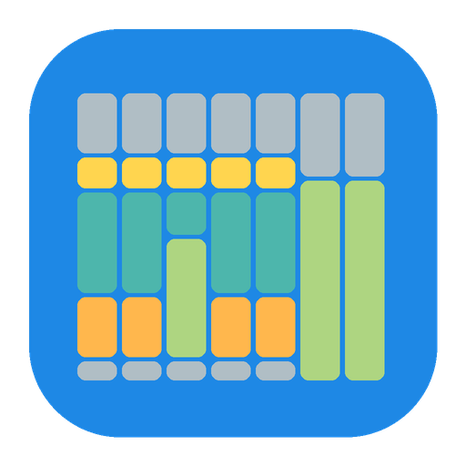
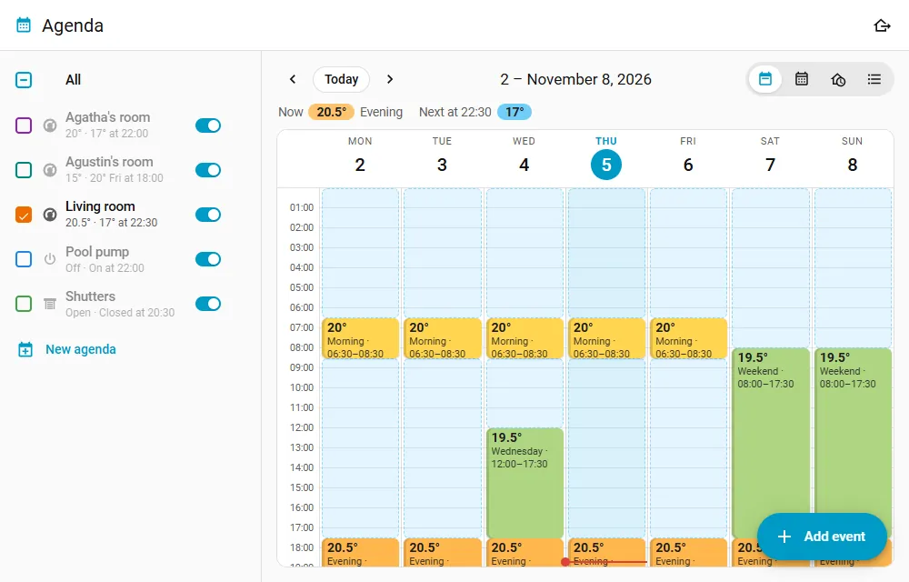
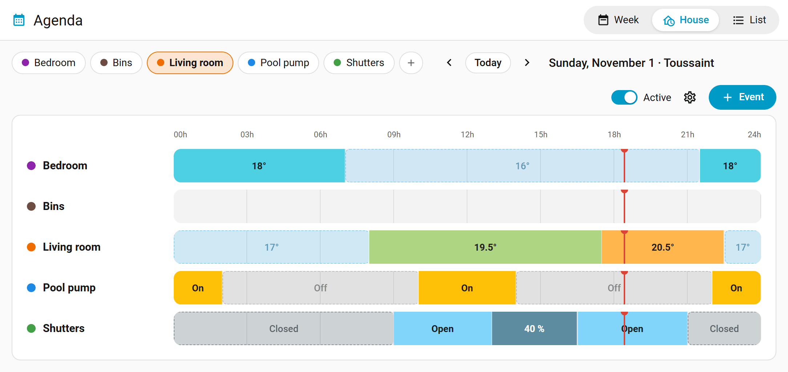
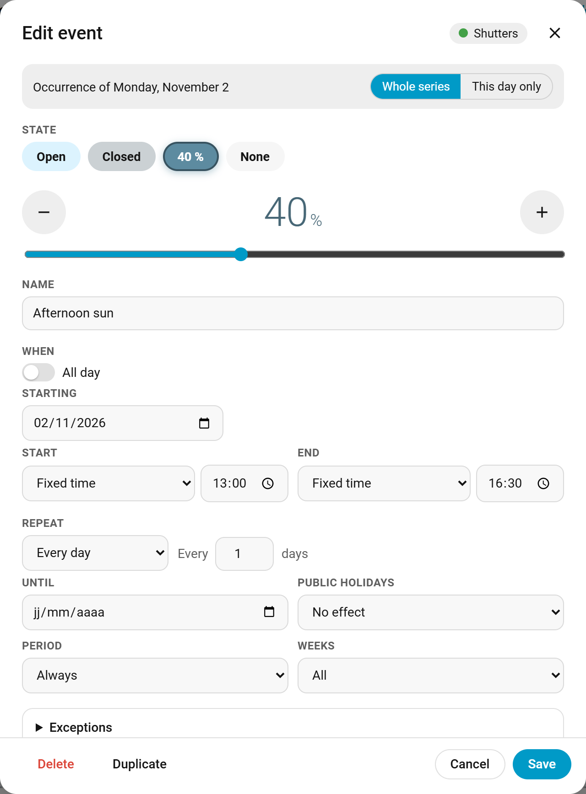
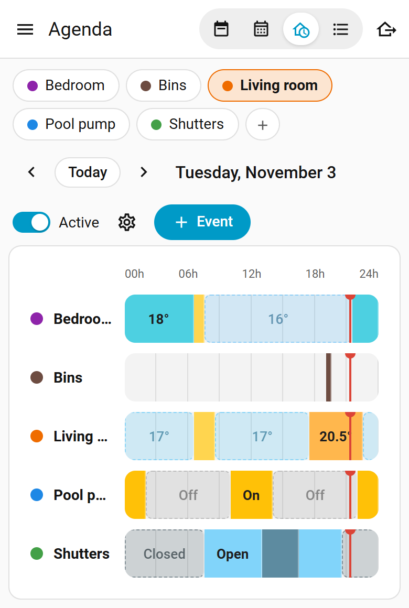

# Agenda für Home Assistant

Zeitplanung per Kalender für Home Assistant, nach dem Vorbild des Agenda-Plugins von Jeedom.
Jeder Raum oder jedes Gerät bekommt eine eigene Agenda, als Woche dargestellt, die man durch
Verschieben von Blöcken bearbeitet.

[](https://my.home-assistant.io/redirect/marketplace_repository/?owner=jolabs40&repository=agenda-ha&category=integration)
[](https://github.com/jolabs40/agenda-ha/actions/workflows/validate.yml)

[English version](README.md) · [Version française](README.fr.md) · [Nederlandse versie](README.nl.md)



[Die zweiminütige Vorstellung auf YouTube ansehen](https://youtu.be/GYiXai78Mzg), mit Untertiteln in neun Sprachen, auch auf Deutsch.

Ein Termin legt fest, was die verknüpften Geräte tun sollen (eine Temperatur, ein Modus, ein oder
aus, eine Rollladenposition, eine Option, ein Wert), und kann zu Beginn und am Ende Aktionen
ausführen. Außerhalb der Termine kehrt die Agenda in ihren Standardzustand zurück.

Die Bildschirmfotos sind auf Englisch; die Oberfläche erscheint auf Deutsch, wenn Home Assistant
auf Deutsch eingestellt ist.

## Funktionen

- Ein Panel in der Seitenleiste mit vier Ansichten:
  - Woche: ein Klick auf einen freien Zeitraum legt einen Termin an, ein Block wird per Ziehen
    verschoben und durch Ziehen am unteren Rand verlängert. Bei einem wiederholten Termin wählt man
    zwischen nur diesem Tag und der ganzen Serie. Auf einem Touchscreen hebt ein langes Drücken den
    Block an. Ein Tag lässt sich auf andere Tage der Woche kopieren.
    Ein Block nennt die Kalender, von denen sein Termin abhängt, und umrandet den, der ihn an diesem
    Tag auslöst; Tage, die ein Kalender aus einer Serie nimmt, erscheinen schraffiert.
    Ein ausgeschalteter Termin (Termin aktiv, in seinem Editor) erscheint blass und
    durchgestrichen, um ihn zu öffnen und wieder einzuschalten; der Block eines Termins mit
    Aktionen trägt ein kleines Zeichen.
  - Monat: die Termine jedes Tages, mit Feiertagen und Schulferien.
  - Haus: alle Agenden über einen Tag, mit dem, was jedes Gerät gerade tut, und bei Thermostaten
    der gemessenen Temperatur unter dem Sollwert.
  - Liste: alle Termine und ihre Wiederholung.
- Auf einem breiten Bildschirm stehen die Agenden in einer Spalte, wie im Kalender-Panel: die
  anzuzeigenden ankreuzen, sehen, was jede gerade tut und wann sie wechselt, sie pausieren oder ihre
  Einstellungen öffnen. Auf dem Telefon erledigen das Chips oben. Der Knopf Termin hinzufügen sitzt
  unten rechts. Das Panel öffnet sich je Browser mit dem zuletzt gewählten Reiter, und das Zahnrad
  in der Zeile Alle führt zu den gemeinsamen Einstellungen. Der Rand der Spalte lässt sich ziehen,
  um sie zu verbreitern, und auch das merkt sich jeder Browser.
- Duplizieren, in den Einstellungen einer Agenda, legt eine Kopie an: gleiche Einstellungen, gleiche
  Termine, ohne die Geräte, die danach gewählt werden.
- Andere Kalender von Home Assistant (Schulferien, ein Familienkalender...) lassen sich in derselben
  Spalte ankreuzen und erscheinen schraffiert in Woche, Monat und Haus, nur zur Information.
- Ein Termin kann mehrere Tage dauern, von einem Datum und einer Uhrzeit bis zu anderen, wiederholt
  oder nicht. Seine Ausnahmen richten sich nach dem Tag, an dem er beginnt.
- Wiederholung alle N Tage, Wochen (an gewählten Wochentagen, oder nur in geraden oder ungeraden
  Wochen) oder Monate (am gleichen Datum, am 2. Montag, am letzten Freitag...), auf Wunsch bis zu
  einem Datum. Einzelne Tage lassen sich aus einer Serie entfernen oder hinzufügen.
- Beginn oder Ende eines Termins können dem Sonnenaufgang oder Sonnenuntergang folgen, mit
  Versatz, nicht vor oder spätestens zu einer bestimmten Uhrzeit.
- Bedingungen auf Entitäten: ein Termin übernimmt nur, solange zum Beispiel jemand zu Hause ist,
  ein Fenster geschlossen ist oder die Außentemperatur unter 5 °C liegt; alle, oder mindestens eine
  davon.
- Ein Sollwert oder ein Wert kann einer Entität folgen, zum Beispiel einem `input_number` oder
  einem Template-Sensor: ändert man sie, ändert sich jeder Termin mit, der ihr folgt. Der Wert des
  Termins gilt, solange die Entität keinen hat.
- Die Feiertage des eigenen Landes können übersprungen werden oder die einzigen Tage sein.
- Kalender können als Bedingung dienen: Tage mit einem Termin darin überspringen (Reisen,
  Abwesenheiten), nur diese Tage behalten oder beides beim selben Termin. Bei mehreren Kalendern
  genügt ein Termin in einem davon, oder es braucht einen in jedem.
  Die Feiertage können einer dieser Kalender sein, für einen Termin, der an Homeoffice-Tagen oder
  an Feiertagen läuft. Ein Kalender kann auch nur seine Termine mit einem bestimmten Text zählen,
  etwa die teuren Tage eines Stromtarif-Kalenders.
  Auch die eigene Agenda des Termins kann einer davon sein: ein wiederholter Freitag weicht einer
  Urlaubswoche in derselben Agenda. Dann zählen nur die Termine, die nicht von ihr abhängen.
- Ein Kalender der Schulferien wird einmal für alle Agenden gewählt. Jeder wiederholte Termin gilt
  dann immer, nur in der Schulzeit oder nur in den Schulferien, und die Wochenansicht markiert die
  Ferien.
- Aktionen zu Beginn und am Ende jedes Termins, mit dem gewohnten Aktionseditor von Home Assistant.
- Änderungen von Hand werden respektiert: ein von Hand eingestelltes Gerät bleibt so bis zum
  nächsten Wechsel, oder bis zum nächsten Tag, oder wird sofort zurückgesetzt, je nach Agenda. Ein
  Neustart behält sie.
- Abweichungen: Zum Nächsten wendet den nächsten Wechsel sofort an, Jetzt anwenden (im
  Termineditor) wendet einen Termin bis zu seinem Ende an, Zeitplan fortsetzen hebt sie auf.
- Jedes Gerät wird nachverfolgt. Ist es nicht verfügbar, bekommt es seinen Zustand, sobald es
  zurück ist; übernimmt es ihn nicht, gibt es einen zweiten Versuch, dann ein Problem unter
  Reparaturen. Geräte ohne Zustandsrückmeldung (Funk-Rollläden) bekommen ihren Befehl einmal,
  nacheinander mit einer kurzen Pause.
- Klimageräte: ein Termin kann Modus, Lüfterstufe und Schwenken zusammen mit der Temperatur
  einstellen, oder nur einen Modus (nur Lüfter, Entfeuchten).
- Ein Abwesenheitsmodus für das ganze Haus: die Agenden, die ihm folgen, behalten ihren
  Abwesenheitszustand bis zu einem Datum oder bis er beendet wird. Die anderen (Lampen) können
  derweil Anwesenheit simulieren. Ein Schalter zeigt ihn den Automatisierungen, und die
  Dashboard-Karte hat seinen Knopf.
- Pro Agenda: eine `calendar`-Entität (Kalender-Panel, Kalender-Auslöser), ein Schalter Aktiv, der
  die Agenda pausiert, die Sensoren Jetzt und Nächste Änderung.
- Aktionen für Automatisierungen und Sprachassistenten: den nächsten Termin überspringen, Daten
  hinzufügen oder entfernen, vom Zeitplan abweichen, den Abwesenheitsmodus starten oder beenden.
- Das Logbuch nennt die Agenda, die ein Gerät geändert hat, und zwei Ereignisse lassen
  Automatisierungen reagieren.
- Benutzer ohne Administratorrechte können Termine und die Abwesenheit bearbeiten dürfen; Start-
  und Endaktionen bleiben den Administratoren vorbehalten.
- Nach einem Neustart werden die verknüpften Geräte in den Zustand gebracht, den die Agenda
  vorsieht (pro Agenda abschaltbar), außer den von Hand eingestellten.
- Eine Dashboard-Karte, `custom:agenda-card`, mit visuellem Editor.
- Solltemperatur pünktlich erreichen: Ein Thermostat startet so früh wie nötig, damit der Raum zu
  Beginn des Termins die Solltemperatur hat. Wie schnell der Raum warm wird, wird gelernt.
- Temperaturen in °C oder °F, wie in Home Assistant eingestellt.
- Auf Englisch, Französisch, Deutsch und Niederländisch.

Was eine Agenda steuern kann:

| Typ | Entitäten | Zustände |
|---|---|---|
| Thermostate | `climate` | Temperatur (mit Modus, Lüfterstufe und Schwenken bei Klimageräten), Voreinstellung, nur Modus, aus |
| Ein / aus | `switch`, `light`, `input_boolean`, `fan` | ein (mit Helligkeit bei Lampen), aus |
| Rollläden | `cover` | offen, geschlossen, Position |
| Auswahl | `select`, `input_select` | eine der Optionen |
| Wert | `number`, `input_number` | eine Zahl |
| Nichts | | nur Aktionen |

Bei Thermostaten, die die Temperaturen ihrer Modi veröffentlichen (Versatile Thermostat tut das),
erscheinen sie neben den Namen der Modi.

| Hausansicht | Termineditor | Telefon |
|---|---|---|
|  |  |  |

## Installation

Unter Einstellungen > Marketplace nach Agenda suchen (oder den Knopf oben verwenden) und
Installieren wählen. Die Einrichtung einer ersten Agenda folgt, ohne Neustart.

Taucht es noch nicht auf, Über Link hinzufügen wählen und `https://github.com/jolabs40/agenda-ha`
eingeben (dafür wird eine Verbindung mit GitHub verlangt).

Vor Home Assistant 2026.11 war der Marketplace die Integration HACS: dort nach Agenda suchen,
herunterladen und Home Assistant neu starten.

Ohne beides `agenda.zip` aus der [neuesten Version](https://github.com/jolabs40/agenda-ha/releases/latest)
in einen Ordner `custom_components/agenda` der Konfiguration entpacken (oder diesen Ordner aus dem
Repository kopieren) und Home Assistant neu starten.

Nach HACS oder einer Kopie von Hand die Integration Agenda unter Einstellungen > Geräte & Dienste
hinzufügen. Jeder Eintrag ist eine Agenda; weitere lassen sich im Panel mit dem Knopf Neue Agenda anlegen. Alles andere wird im
Agenda-Panel eingestellt.

Erfordert Home Assistant 2024.7 oder neuer. Das Paket `holidays` wird automatisch installiert. Das
Symbol der Integration erscheint ab Home Assistant 2026.3.

## Welcher Zustand gilt

- Der laufende Termin bestimmt den Zustand. Außerhalb der Termine gilt der Standardzustand der
  Agenda. Termine ohne Zustand (Erinnerungen, nur Aktionen) zählen hier nicht.
- Überschneiden sich Termine, gewinnt der zuletzt begonnene, bei Gleichstand der kürzere. Ein
  ganztägiger Wochenend-Termin und ein Nacht-Termin, der um Mitternacht beginnt: die Nacht gewinnt
  bis zu ihrem Ende, dann übernimmt das Wochenende.
- Bei jedem Wechsel laufen zuerst die Aktionen am Ende, dann wird der Zustand angewendet, dann
  laufen die Aktionen zu Beginn. Thermostate erhalten ihren Sollwert zu Beginn jedes Termins.
  Andere Geräte werden nur angesprochen, wenn ihr Zustand abweicht, außer Geräten ohne
  Zustandsrückmeldung: was sie anzeigen, ist nur eine Annahme, sie bekommen ihren Befehl also immer.
- Zeiten sind lokale Uhrzeiten: ein Termin um 21:30 bleibt bei der Zeitumstellung um 21:30.
- Der Schalter Aktiv pausiert die Agenda vollständig.

## Änderungen von Hand

Ein von Hand eingestelltes Gerät, am Gerät selbst oder in Home Assistant, wird als solches erkannt.
Die Einstellung Änderungen von Hand jeder Agenda bestimmt, was folgt:

| Auswahl | Was die Agenda tut |
|---|---|
| Bis zum nächsten Wechsel behalten (Vorgabe) | lässt es bis zum Beginn oder Ende des nächsten Termins |
| Bis zum nächsten Tag behalten | lässt es bis Mitternacht |
| Sofort wieder so, wie die Agenda es will | setzt es nach 5 Sekunden zurück; nach drei Malen in zehn Minuten lässt sie es bis zum nächsten Wechsel |
| Die Agenda hat immer Vorrang | übergeht es, der nächste Wechsel gilt wie gewohnt |

Ein Neustart behält diese Änderungen, `agenda.resync` ebenso. Jetzt anwenden in den Einstellungen
holt alle Geräte zurück. Die Spalte zeigt "von Hand eingestellt bis...", und der Sensor Jetzt
listet diese Geräte im Attribut `set_by_hand`.

Ein Thermostat, das sich selbst abschaltet, wurde nicht von Hand geändert: Versatile Thermostat
schaltet sich bei offenem Fenster, durch sein automatisches Starten und Stoppen oder seinen
zentralen Modus selbst ab und behält, was von ihm verlangt wurde. Die Agenda richtet sich nach
dieser Anforderung: Sie hält den Stopp nicht für eine Änderung von Hand und sendet ein
zwischenzeitlich fälliges Aus trotzdem.

Abweichungen ändern den Zeitplan selbst, bis zu der Uhrzeit, die sie anzeigen (`override_until`
am Sensor Jetzt): Zum Nächsten wendet den Zustand des nächsten Wechsels sofort an (noch einmal:
den danach), Jetzt anwenden im Termineditor wendet den Zustand dieses Termins bis zum Ende seines
nächsten Vorkommens an. Zeitplan fortsetzen hebt beide auf und holt die von Hand eingestellten
Geräte zurück.

## Solltemperatur pünktlich erreichen

Ohne diese Einstellung bekommt ein Thermostat seine Solltemperatur zu Beginn des Termins, und der
Raum wird erst dann warm. Mit Solltemperatur pünktlich erreichen, in den Einstellungen einer
Thermostat-Agenda, startet es früher, damit der Raum rechtzeitig so weit ist. Das gilt für jede
`climate`-Entität (Heizkörperthermostat, Klimaanlage, Wärmepumpe, Versatile Thermostat), und eine
Klimaanlage kühlt auf dieselbe Weise früher. Die Einstellung ist standardmäßig aus.

Bei jedem Anstieg lernt die Agenda, wie schnell der Raum ist, in °C pro Stunde, und wie lange das
Gerät zum Anlaufen braucht, für jedes Thermostat, Heizen und Kühlen getrennt. Sie braucht drei
Anstiege; bis dahin rechnet sie mit 1,5 °C/h beim Heizen, 2,5 °C/h beim Kühlen und 10 Minuten
Anlauf. Der Vorlauf ist dieser Anlauf plus die Zeit des Anstiegs, mit 10 % Reserve, bis zum Längsten
Vorlauf (standardmäßig 3 Stunden, von 15 Minuten bis 6 Stunden). Mit mehreren Thermostaten in einer
Agenda entscheidet das langsamste, und alle starten gemeinsam.

Ein Anstieg zählt nicht, wenn jemand das Gerät ändert, wenn es ausgeht oder nicht erreichbar ist,
wenn sich seine Solltemperatur ändert, während einer Abwesenheit, wenn er länger als das Doppelte des
längsten Vorlaufs dauert oder wenn der Abstand zu Beginn höchstens 0,5 °C beträgt. Ein offenes
Fenster zeigt sich so: Das Gerät geht aus oder ändert seine Solltemperatur, oder die Messung fällt.

Zur berechneten Zeit gilt der ganze Zustand des Termins: Solltemperatur, Modus, Lüfter, Schwenken.
Eine ausgeschaltete Klimaanlage startet also im richtigen Modus. Startaktionen bleiben beim Beginn.

| Fall | Was die Agenda tut |
|---|---|
| Termin mit Voreinstellung, nur Modus oder Aus | nichts früher, es fehlt eine Zahl als Ziel |
| Rückweg zu einer niedrigeren Solltemperatur beim Heizen, einer höheren beim Kühlen | nichts früher |
| Agenda pausiert, Abwesenheit, Abweichung, Gerät von Hand geändert, Bedingung falsch | nichts früher |
| Ein anderer Termin hat schon begonnen | er weicht dem frühen Start |
| Ein anderer Termin beginnt zwischen dem frühen Start und dem Beginn | er behält die Führung bis zu seinem Ende, der frühe Start wartet |
| Die Schätzung sinkt nach dem frühen Start | er läuft weiter |
| Der Termin verschwindet, seine Bedingung wird falsch, die Abwesenheit beginnt, die Agenda wird pausiert | er endet, und die Agenda kehrt zum gewünschten Zustand zurück |

Gemessen wird am Thermostat. Das Thermometer einer Klimaanlage oder eines Heizkörperthermostats
weicht oft von der Raumtemperatur ab: Temperatursensor des Raums ersetzt es durch einen Sensor, und
ohne Wert dieses Sensors startet nichts früher. Überschreitet die Messung in der Stunde nach einem
Anstieg die Solltemperatur meist um 0,8 °C oder mehr, weisen die Einstellungen der Agenda darauf hin:
Sie stammt wohl aus der Nähe des Geräts, und die gelernten Geschwindigkeiten sind zu hoch.
Außentemperatur, in den gemeinsamen Einstellungen,
nimmt einen Sensor oder eine `weather`-Entität und korrigiert die gelernte Geschwindigkeit je nach
Wetter um höchstens 30 %.

Die Einstellungen der Agenda zeigen die gelernten Geschwindigkeiten und eine Schaltfläche, um sie zu
vergessen, wie die Aktion `agenda.reset_learning` (auf dem Kalender der Agenda, `climate` für nur ein
Thermostat). Der Sensor Aufheizgeschwindigkeit gibt die Geschwindigkeit in °C/h an, mit `cool_rate`,
`dead_time`, `samples` und `last_sample`. Der Sensor Nächste Änderung hat die Attribute
`preheat_start` und `preheat_minutes`, sobald die Zeit berechnet ist. Die Ansichten Woche und Haus
zeichnen ein schraffiertes Band vor dem Termin, und `agenda_state_applied` trägt den Grund `preheat`
mit `preheat_minutes`, `preheat_start` und `target_time`. Das Logbuch sagt: "Vorheizen durch Agenda
Schlafzimmer: 20 °C für 07:00 (Beginn 05:42)".

## Aktionen

Aktionen funktionieren wie in Automatisierungen, mit drei zusätzlichen Variablen:

| Variable | Inhalt |
|---|---|
| `agenda` | Name der Agenda |
| `phase` | `start` oder `end` |
| `event` | `id`, `name`, `start`, `end` (ISO-Daten) |

```yaml
- action: notify.mobile_app_telefon
  data:
    message: "{{ event.name }} ({{ agenda }}) {{ 'beginnt' if phase == 'start' else 'endet' }}"
```

Nur Administratoren legen Aktionen fest. Benutzer, die Termine bearbeiten dürfen, sehen sie nicht,
und ihre Änderungen behalten die vorhandenen Aktionen.

In der Woche trägt der Block eines Termins mit Aktionen unten rechts ein kleines Zeichen.

## Sonnenaufgang, Sonnenuntergang und Bedingungen

Die Sonnenzeiten berechnet Home Assistant Tag für Tag für den Standort, der unter Einstellungen >
System > Allgemein eingestellt ist. Bringt die Sonne das Ende eines Termins vor seinen Beginn
(Sonnenuntergang nach einem festen Ende um 21:00 im Sommer), findet der Termin an diesem Tag nicht
statt. Nicht vor und Spätestens begrenzen eine Sonnenzeit: Rollläden, die bei Sonnenuntergang
schließen, aber nicht vor 18:00.

Bedingungen vergleichen den Zustand einer Entität: `person.alex` ist `home`, `binary_sensor.fenster`
ist nicht `on`, `sensor.aussentemperatur` ist unter `5`. Bei mehreren Bedingungen braucht der
Termin alle oder mindestens eine davon. Sie werden zu Beginn des Termins und bei jeder Änderung der
Entität gelesen. Ein Termin, dessen Bedingungen nicht mehr erfüllt sind, überlässt die Steuerung
dem nächsten Termin oder dem Standardzustand; seine Aktionen am Ende laufen trotzdem. Eine Entität,
die nicht mehr verfügbar ist, behält ihren letzten Zustand zehn Minuten lang, auch über einen
Neustart: ein Sensor, der kurz ausfällt, ändert nichts.

Die Woche zeichnet einen Termin, dessen Bedingungen gerade nicht erfüllt sind, blass und
durchgestrichen, wie einen Tag, den ein Kalender entfernt: mit einem Termin pro Modus zur selben
Zeit erscheint nur der des aktuellen Modus. Kommende Tage werden gezeichnet, als behielten die
Bedingungen ihren jetzigen Zustand.

## Ein Wert, der einer Entität folgt

Der Sollwert eines Thermostats oder der Wert eines Wert-Agendas kann statt einer festen Zahl einer
Entität folgen: einem `input_number`, einem `number` oder einem Sensor, etwa einem Template-Sensor,
der einen Wert pro Modus liefert. Das Gerät erhält den Wert der Entität zu Beginn des Termins und
bei jeder Änderung, auf seine Schrittweite gerundet und in seinen Grenzen. Die im Termin
eingestellte Zahl gilt, solange die Entität keinen Wert hat; eine Entität, die nicht mehr
verfügbar ist, behält zuerst zehn Minuten lang ihren letzten Wert.

## Abwesenheitsmodus

Der Knopf oben im Panel oder auf der Dashboard-Karte startet ihn, bis zu einem Datum oder bis er
beendet wird; die Aktionen
`agenda.set_absence` und `agenda.end_absence` tun dasselbe aus einer Automatisierung. In dieser Zeit
behält jede Agenda, die ihm folgt (eine Option in ihren Einstellungen), ihren Abwesenheitszustand
oder sonst ihren Standardzustand und führt keine Aktion aus. Am Ende kehrt jede Agenda zu ihrem
Programm zurück.

Der Schalter `switch.agenda_absence` ist während einer Abwesenheit an, mit ihrem Ende im Attribut
`until` (leer, wenn sie bis zum Beenden dauert): eine Automatisierung kann darauf reagieren, und
ihn einzuschalten startet eine Abwesenheit, bis er ausgeschaltet wird. Wie im Panel sind der
Schalter und beide Aktionen den Administratoren vorbehalten, außer die gemeinsamen Einstellungen
erlauben Benutzern, Termine und die Abwesenheit zu bearbeiten; Automatisierungen betrifft das
nicht.

Eine Agenda, die ihm nicht folgt, kann stattdessen Anwesenheit simulieren (Anwesenheitssimulation,
in ihren Einstellungen): während einer Abwesenheit verschieben sich ihre Beginn- und Endzeiten
zufällig um bis zu der gewählten Anzahl Minuten, früher oder später, damit die Lampen nicht jeden
Tag zur selben Zeit angehen.

## Automatisierungen

| Aktion | Ziel | Daten |
|---|---|---|
| `agenda.skip_next` | der Kalender einer Agenda | `event` (Name, optional): entfernt den nächsten Termin |
| `agenda.add_dates` | der Kalender einer Agenda | `event`, `dates`: fügt an diesen Tagen Termine hinzu |
| `agenda.remove_dates` | der Kalender einer Agenda | `event`, `dates`: entfernt die Termine an diesen Tagen |
| `agenda.advance` | der Kalender einer Agenda | wendet den nächsten Wechsel sofort an (Zum Nächsten) |
| `agenda.apply_event` | der Kalender einer Agenda | `event` (Name): wendet diesen Termin bis zum Ende seines nächsten Vorkommens an |
| `agenda.resume` | der Kalender einer Agenda | beendet die Abweichung und holt die von Hand eingestellten Geräte zurück |
| `agenda.reset_learning` | der Kalender einer Agenda | vergisst die gelernten Geschwindigkeiten, aller Thermostate oder eines einzelnen (`climate`) |
| `agenda.set_absence` | | `until` (optional): startet den Abwesenheitsmodus |
| `agenda.end_absence` | | beendet ihn |
| `agenda.resync` | der Kalender einer Agenda | bringt die Geräte in den Zustand, den die Agenda jetzt vorsieht, außer den von Hand eingestellten |

```yaml
- action: agenda.skip_next
  target:
    entity_id: calendar.agenda_wohnzimmer
  data:
    event: Morgen
```

Die `calendar`-Entität jeder Agenda funktioniert auch mit dem Kalender-Auslöser von Home
Assistant, bei Bedarf mit Versatz:

```yaml
triggers:
  - trigger: calendar
    event: start
    entity_id: calendar.agenda_wohnzimmer
    offset: "-0:15:00"
actions:
  - action: notify.mobile_app_telefon
    data:
      message: "{{ trigger.calendar_event.summary }} in 15 Minuten"
```

## Ereignisse und Logbuch

Jeder Zustand, den ein Gerät bekommt, löst `agenda_state_applied` aus; ein Gerät, das ihn nach
einem zweiten Versuch noch nicht anzeigt, löst `agenda_state_failed` aus und bekommt ein Problem
unter Reparaturen. Ihre Daten: `agenda`, `entry_id`, `entity_id`, `state`, `label` (der Zustand,
wie ihn das Panel zeigt), und bei `agenda_state_applied` der Grund `reason` (`schedule`, `edit`,
`resync`, `available`, `retry`, `preheat`...) sowie der Termin `event` (`id` und `name`), wenn ein Termin ihn
bestimmt hat.

```yaml
triggers:
  - trigger: event
    event_type: agenda_state_failed
actions:
  - action: notify.mobile_app_telefon
    data:
      message: "{{ trigger.event.data.entity_id }} hat {{ trigger.event.data.label }} nicht übernommen"
```

Das Logbuch zeigt für jeden angewendeten Zustand eine Zeile ("von der Agenda Schlafzimmer eingestellt:
19 °C"), und die Änderungen des Geräts nennen die Agenda als Ursache. Ist das Logbuch auf ein Gerät
gefiltert, behält Home Assistant nur die Zeilen der Integration dieses Geräts: die Ursache steht
dort weiterhin, die Zeile der Agenda nur im vollständigen Logbuch.

## Feiertage

Sie folgen dem Land, das unter Einstellungen > System > Allgemein eingestellt ist. Ein anderes Land
oder eine Region (ein Bundesland, ein Kanton, ein US-Bundesstaat...) lässt sich in den
Einstellungen jeder Agenda wählen und gilt für alle.

In den Ausnahmen eines Termins steht Feiertage auch ganz oben in den Kalenderlisten. Die
Einstellung Feiertage schränkt die Tage immer ein, eine Liste dagegen verbindet ihre Kalender: mit
Homeoffice und Feiertage unter Nur an Tagen mit einem Termin (in mindestens einem davon, die
Vorgabe) läuft der Termin an Homeoffice-Tagen wie an Feiertagen.

## Schulferien

Einen Kalender mit den Schulferien hinzufügen, zum Beispiel mit der Integration Remote Calendar und
einem veröffentlichten iCal-Kalender der Ferien des eigenen Bundeslandes, und ihn dann in den
gemeinsamen Einstellungen einer beliebigen Agenda wählen.

Ein Kind, das unter der Woche im Internat ist, zum Beispiel: die Wochentags-Termine als Schulzeit
markieren und einen täglichen ganztägigen Termin mit der Temperatur für zu Hause als Schulferien.

## Dashboard-Karte

```yaml
type: custom:agenda-card
view: house                         # alle Agenden, heute
agendas: [Schlafzimmer, Wohnzimmer] # optional: nur diese, in dieser Reihenfolge
title: Heizung                      # optional
```

```yaml
type: custom:agenda-card
view: week
agenda: Schlafzimmer
```

```yaml
type: custom:agenda-card
view: next                          # Restzeit, Zustand, nächster Wechsel, Zum Nächsten und Fortsetzen
agendas: [Schlafzimmer]
```

Die Karte hat einen visuellen Editor. Ein Klick darauf öffnet das Panel. Jede Ansicht hat einen
Knopf, um den Abwesenheitsmodus zu starten oder zu beenden, für die Benutzer, die es dürfen, und
während einer Abwesenheit einen Hinweis.

Alle Optionen sind optional:

| Option | Ansicht | Wirkung |
|---|---|---|
| `agendas` | house, next | die angezeigten Agenden, in dieser Reihenfolge; sonst alle, nach Name |
| `names` | alle | ein anderer Name in der Karte, zum Beispiel `names: {Warmwasser Paar: Paar}` |
| `title`, `icon` | alle | die Kopfzeile; `title: ""` lässt sie weg |
| `absence: false` | alle | weder Abwesenheitsknopf noch Hinweis |
| `tap_action` | alle | was ein Klick tut, wie bei den Karten von Home Assistant; standardmäßig das Panel, `{action: none}` für nichts |
| `start_hour`, `end_hour` | house | die angezeigten Stunden, von 0 bis 24 |
| `name_width`, `row_height` | house | Breite der Namen und Höhe einer Zeile, in Pixeln |
| `live: false` | house | ohne die Zeile unter dem Namen, was das Gerät gerade tut |
| `curve: false` | house | ohne Temperaturkurve |
| `buttons: false` | next | ohne die Knöpfe Zum Nächsten und Fortsetzen |
| `days` | week | von 1 bis 7; weniger als 7 beginnt heute |
| `hour_height` | week | Höhe einer Stunde, in Pixeln |

## Ein Problem melden

Unter Einstellungen > Geräte & Dienste > Agenda bietet das Menü der betroffenen Agenda
Diagnosedaten herunterladen: eine Datei mit ihren Einstellungen und Terminen, ihren Geräten, wie
sie gerade sind, und den letzten gesendeten Befehlen mit dem, was jedes Gerät anzeigte. Diese an
ein Issue auf [GitHub](https://github.com/jolabs40/agenda-ha/issues) anhängen, mit dem, was erwartet wurde, und wann.

Für mehr bietet das Menü oben auf derselben Seite Debug-Protokoll aktivieren: auf das Problem
warten, dann Debug-Protokoll deaktivieren, und Home Assistant lädt das Protokoll herunter.

## Unterstützung

Agenda ist kostenlos. Wenn es dir nützt, kannst du mir auf [Ko-fi](https://ko-fi.com/jolabs40) einen Kaffee spendieren.

[](https://ko-fi.com/jolabs40)

Ein Stern für dieses Repository hilft anderen ebenfalls, es zu finden.

## Lizenz

[MIT](LICENSE)
