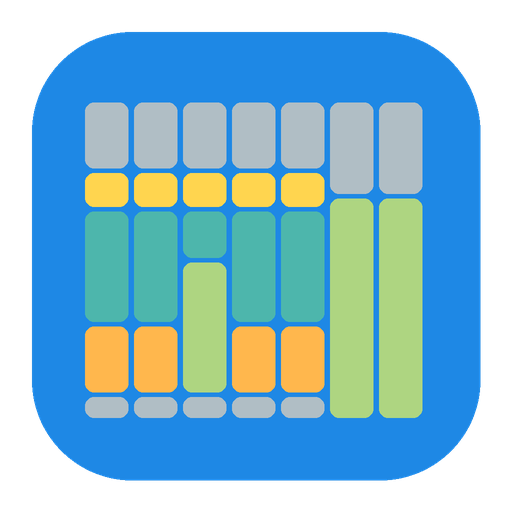
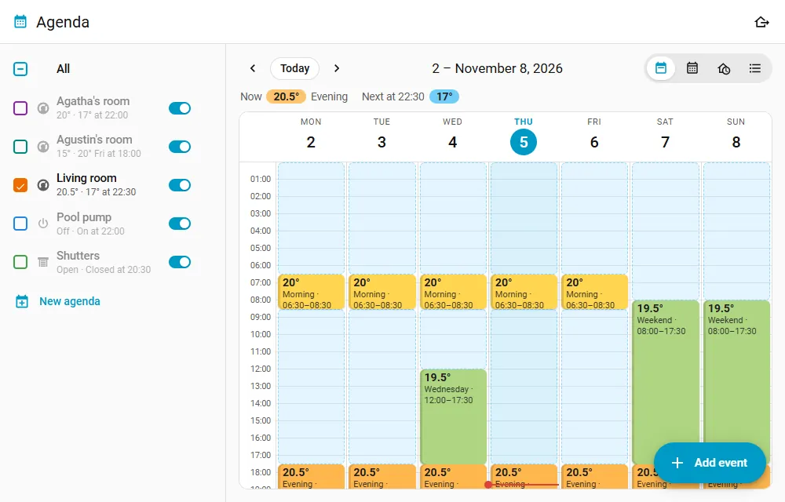
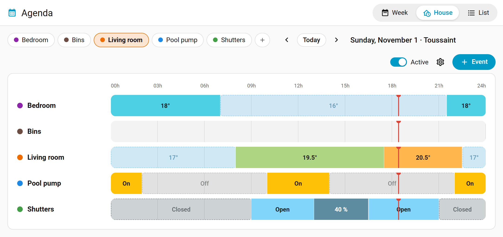
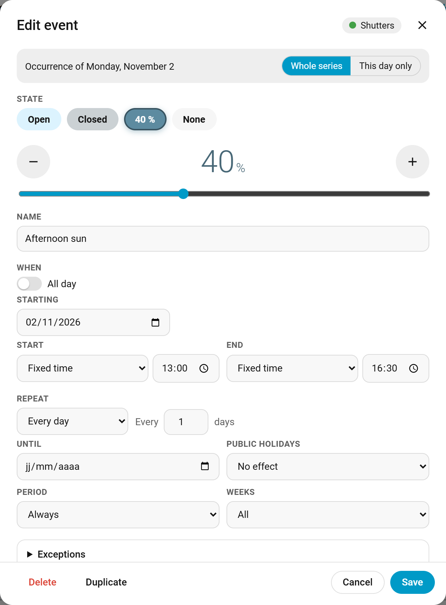
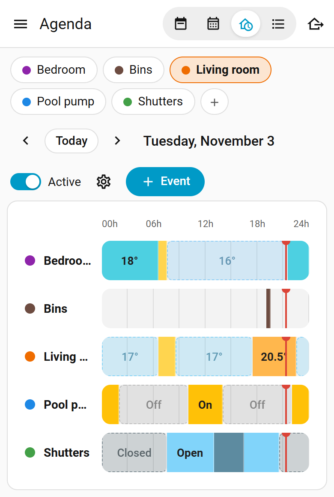

# Agenda pour Home Assistant

La programmation par calendrier pour Home Assistant, dans l'esprit du plugin Agenda de Jeedom.
Chaque pièce ou appareil a son agenda, présenté comme une semaine que l'on modifie en déplaçant
des blocs.

[](https://my.home-assistant.io/redirect/marketplace_repository/?owner=jolabs40&repository=agenda-ha&category=integration)
[](https://github.com/jolabs40/agenda-ha/actions/workflows/validate.yml)

[English version](README.md) · [Deutsche Version](README.de.md) · [Nederlandse versie](README.nl.md)



[Voir la présentation de deux minutes sur YouTube](https://youtu.be/GYiXai78Mzg), sous-titrée en neuf langues dont le français.

Un événement fixe ce que font les appareils liés (une température, un mode, marche ou arrêt, la
position d'un volet, une option, une valeur) et peut lancer des actions à son début et à sa fin.
Hors événement, l'agenda revient à son état par défaut.

Les captures sont en anglais ; l'interface s'affiche en français si Home Assistant l'est.

## Fonctions

- Un panneau dans la barre latérale, avec quatre vues :
  - Semaine : un clic sur un créneau vide ajoute un événement, on déplace un bloc en le faisant
    glisser, on l'allonge en tirant son bord bas. Pour un événement répété, on choisit entre ce
    jour seulement et toute la série. Sur un écran tactile, un appui long saisit le bloc. Une
    journée se copie vers d'autres jours de la semaine.
    Un bloc nomme les calendriers dont dépend son événement et entoure celui qui le déclenche ce
    jour-là ; les jours qu'un calendrier retire d'une série apparaissent hachurés.
    Un événement désactivé (Événement actif, dans son éditeur) apparaît pâle et barré, pour
    l'ouvrir et le réactiver ; le bloc d'un événement qui a des actions porte une petite marque.
  - Mois : les événements de chaque jour, avec les jours fériés et les vacances scolaires.
  - Maison : tous les agendas sur une journée, avec ce que fait chaque appareil en ce moment et,
    pour les thermostats, la température mesurée tracée sous la consigne.
  - Liste : tous les événements et leur répétition.
- Sur un grand écran, les agendas sont listés dans une colonne, comme dans le panneau Calendrier :
  on coche ceux à afficher, on voit ce que fait chacun et son prochain changement, on le suspend ou
  on ouvre ses réglages. Sur un téléphone, des pastilles en haut font de même. Le bouton Ajouter un
  événement se trouve en bas à droite. Le panneau s'ouvre sur le dernier onglet choisi, navigateur
  par navigateur, et la roue dentée de la ligne Tous mène aux réglages communs. Le bord de la
  colonne se glisse pour l'élargir, et chaque navigateur retient aussi sa largeur.
- Dupliquer, dans les réglages d'un agenda, en fait une copie : mêmes réglages, mêmes événements,
  sans les appareils, à choisir ensuite.
- Les autres calendriers de Home Assistant (vacances scolaires, calendrier familial...) se cochent
  dans la même colonne et s'affichent hachurés en semaine, mois et maison, pour information.
- Un événement peut durer plusieurs jours, d'une date et d'une heure à d'autres, répété ou non.
  Ses exceptions regardent le jour où il commence.
- Un agenda peut garder ses événements d'une journée entière sous la date, dans la semaine,
  plutôt qu'en bloc sur toute la colonne : pratique pour les fêtes et les anniversaires.
- Répétition tous les N jours, semaines (jours au choix, ou seulement les semaines paires ou
  impaires) ou mois (même date, 2e lundi, dernier vendredi...), éventuellement jusqu'à une date.
  On peut retirer ou ajouter des jours à une série.
- Le début ou la fin d'un événement peut suivre le lever ou le coucher du soleil, avec un décalage,
  pas avant ou au plus tard à une heure donnée.
- Des conditions sur des entités : un événement ne prend la main que si, par exemple, quelqu'un
  est à la maison, une fenêtre est fermée ou la température extérieure est sous 5 °C ; toutes, ou
  au moins l'une d'elles.
- Une consigne ou une valeur peut suivre une entité, un `input_number` ou un capteur modèle par
  exemple : on la change, et chaque événement qui la suit change avec elle. La valeur de
  l'événement reste en secours tant que l'entité n'en a pas.
- Les jours fériés du pays peuvent être sautés, ou être les seuls jours retenus.
- Des calendriers peuvent servir de condition : sauter les jours où ils ont un événement
  (déplacements, absences), ne garder que ceux-là, ou les deux sur le même événement. Avec plusieurs
  calendriers, un événement dans l'un d'eux suffit, ou il en faut un dans chacun.
  Les jours fériés peuvent être l'un de ces calendriers, pour un événement qui tourne les jours de
  télétravail ou les jours fériés. Un calendrier peut aussi ne compter que ses événements contenant
  un texte : les jours rouges du calendrier RTE Tempo, par exemple.
  L'agenda de l'événement peut lui-même servir de condition : un vendredi répété s'efface devant une
  semaine de congés posée dans le même agenda. Seuls comptent alors les événements qui n'en
  dépendent pas.
- Un calendrier des vacances scolaires se choisit une fois pour tous les agendas. Chaque événement
  répété s'applique alors toujours, seulement en période scolaire ou seulement pendant les
  vacances, et la vue Semaine signale les vacances.
- Des actions de début et de fin par événement, avec l'éditeur d'actions habituel de Home Assistant.
- Les réglages faits à la main sont respectés : un appareil réglé à la main reste tel quel jusqu'au
  prochain changement, ou jusqu'au lendemain, ou il est remis aussitôt, au choix de chaque agenda.
  Un redémarrage les garde.
- Des dérogations : Passer au suivant applique tout de suite le prochain changement, Appliquer
  maintenant (dans l'éditeur d'événement) applique un événement jusqu'à sa fin, Reprendre le
  planning les annule.
- Chaque appareil est suivi. Indisponible, il reçoit son état à son retour ; s'il ne le prend pas,
  il a droit à un second essai, puis à un problème dans Réparations. Les appareils sans retour
  d'état (volets radio) reçoivent leur commande une fois, l'un après l'autre, avec une courte pause.
- Climatiseurs : un événement peut régler le mode, la ventilation et l'oscillation avec la
  température, ou un mode seul (ventilation, déshumidification).
- Un mode absence pour toute la maison : les agendas qui le suivent gardent leur état d'absence
  jusqu'à une date, ou jusqu'à ce qu'on l'arrête. Les autres (lampes) peuvent simuler une présence
  pendant ce temps. Un interrupteur le montre aux automatisations, et la carte de tableau de bord
  a son bouton.
- Pour chaque agenda : une entité `calendar` (panneau Calendrier, déclencheurs de calendrier), un
  interrupteur Actif qui le suspend, les capteurs En ce moment et Prochain changement.
- Des actions pour les automatisations et les assistants vocaux : sauter la prochaine occurrence,
  ajouter ou retirer des dates, déroger au planning, démarrer ou terminer le mode absence.
- Le journal nomme l'agenda qui a changé un appareil, et deux événements permettent aux
  automatisations de réagir.
- Les utilisateurs non administrateurs peuvent être autorisés à modifier les événements et
  l'absence ; les actions de début et de fin restent aux administrateurs.
- Après un redémarrage, les appareils liés sont remis dans l'état prévu (désactivable par agenda),
  sauf ceux réglés à la main.
- Une carte de tableau de bord, `custom:agenda-card`, avec un éditeur visuel.
- Atteindre la consigne à l'heure : un thermostat démarre en avance, de ce qu'il faut pour que
  la pièce soit à la consigne au début de l'événement. La vitesse de la pièce s'apprend toute seule.
- Températures en °C ou en °F, selon le réglage de Home Assistant.
- En français, anglais, allemand et néerlandais.

Ce qu'un agenda peut commander :

| Type | Entités | États |
|---|---|---|
| Thermostats | `climate` | température (avec mode, ventilation et oscillation pour les climatiseurs), préréglage, mode seul, arrêt |
| Marche / arrêt | `switch`, `light`, `input_boolean`, `fan` | marche (luminosité pour les lampes), arrêt |
| Volets | `cover` | ouvert, fermé, position |
| Sélecteur | `select`, `input_select` | une des options |
| Valeur | `number`, `input_number` | un nombre |
| Rien | | actions seulement |

Pour les thermostats qui publient la température de leurs modes (c'est le cas de Versatile
Thermostat), elle s'affiche à côté du nom du mode.

Les options d'un sélecteur qui nomment un niveau de chauffage, celles d'un fil pilote par exemple
(Confort, Confort -1, Confort -2, Eco, Hors gel, Arrêt ou Off), prennent la couleur du mode du même
nom : Confort en orange, Eco en bleu, Hors gel en gris bleuté. L'icône d'un événement peut rester
sur Auto : elle suit alors son état, un soleil pour Confort, une lune pour Eco, un flocon pour Hors
gel, une flamme pour un climatiseur qui chauffe.

| Vue Maison | Éditeur d'événement | Téléphone |
|---|---|---|
|  |  |  |

## Installation

Dans Paramètres > Marketplace, chercher Agenda (ou utiliser le bouton ci-dessus) et choisir
Installer. La configuration d'un premier agenda suit, sans redémarrage.

S'il n'apparaît pas encore, choisir Ajouter grâce à un lien et saisir
`https://github.com/jolabs40/agenda-ha` (une connexion à GitHub est demandée).

Avant Home Assistant 2026.11, la Marketplace était l'intégration HACS : y chercher Agenda, le
télécharger, puis redémarrer Home Assistant.

Sans l'une ni l'autre, décompresser `agenda.zip`, joint à la [dernière version](https://github.com/jolabs40/agenda-ha/releases/latest),
dans un dossier `custom_components/agenda` de la configuration (ou copier ce dossier depuis le
dépôt), puis redémarrer Home Assistant.

Après HACS ou une copie à la main, ajouter l'intégration Agenda depuis Paramètres > Appareils et
services. Chaque entrée est un
agenda ; le bouton Nouvel agenda du panneau en crée d'autres. Tout le reste se règle dans le panneau
Agenda.

Home Assistant 2024.7 ou plus récent. Le paquet `holidays` s'installe tout seul. L'icône de
l'intégration s'affiche à partir de Home Assistant 2026.3.

## Quel état s'applique

- L'événement en cours fixe l'état. Hors événement, c'est l'état par défaut de l'agenda. Les
  événements sans état (rappels, actions seulement) ne comptent pas ici.
- Quand des événements se chevauchent, celui qui a commencé le plus tard l'emporte, et le plus
  court à égalité. Un Week-end sur toute la journée et une Nuit qui commence à minuit : la nuit
  l'emporte jusqu'à sa fin, puis le week-end reprend.
- À chaque changement, les actions de fin passent d'abord, puis l'état, puis les actions de début.
  Les thermostats reçoivent leur consigne au début de chaque événement. Les autres appareils ne
  sont appelés que si leur état diffère, sauf ceux sans retour d'état : ce qu'ils affichent n'est
  qu'une supposition, ils reçoivent donc toujours leur commande.
- Les heures sont celles de l'horloge : un événement à 21h30 reste à 21h30 au changement d'heure.
- Couper l'interrupteur Actif suspend complètement l'agenda.

## Réglages faits à la main

Un appareil réglé à la main, sur lui-même ou dans Home Assistant, est reconnu comme tel. Le
choix Réglage fait à la main, dans les réglages de chaque agenda, décide de la suite :

| Choix | Ce que fait l'agenda |
|---|---|
| Gardé jusqu'au prochain changement (par défaut) | le laisse jusqu'au début ou à la fin du prochain événement |
| Gardé jusqu'au lendemain | le laisse jusqu'à minuit |
| Remis aussitôt comme le veut l'agenda | le remet au bout de 5 secondes ; après trois fois en dix minutes, le laisse jusqu'au prochain changement |
| L'agenda l'emporte toujours | n'en tient pas compte, le prochain changement s'applique comme d'habitude |

Un redémarrage garde ces réglages, `agenda.resync` aussi. Appliquer maintenant, dans les réglages,
reprend tous les appareils. La colonne affiche "réglé à la main jusqu'à...", et le capteur En ce
moment liste ces appareils dans son attribut `set_by_hand`.

Un thermostat qui s'arrête de lui-même n'est pas réglé à la main : Versatile Thermostat s'éteint
seul pour une fenêtre ouverte, son arrêt et relance automatique ou son mode central, et garde ce
qu'on lui a demandé. L'agenda se fie à cette demande : il ne prend pas l'arrêt pour un réglage à
la main, et envoie quand même un Arrêt prévu entre-temps.

Les dérogations changent le planning lui-même, jusqu'à l'heure qu'elles affichent
(`override_until` sur le capteur En ce moment) : Passer au suivant applique tout de suite l'état
du prochain changement (encore une fois : celui d'après), Appliquer maintenant dans l'éditeur
d'événement applique l'état de cet événement jusqu'à la fin de sa prochaine occurrence. Reprendre
le planning annule les deux et reprend les appareils réglés à la main.

## Atteindre la consigne à l'heure

Sans ce réglage, un thermostat reçoit sa consigne au début de l'événement, et la pièce commence
alors à chauffer. Avec Atteindre la consigne à l'heure, dans les réglages d'un agenda de thermostats,
il démarre en avance pour que la pièce y soit à l'heure dite. Cela vaut pour toute entité `climate`
(tête thermostatique, clim, pompe à chaleur, Versatile Thermostat), et une clim refroidit en avance
de la même façon. Le réglage est éteint par défaut.

L'agenda apprend à chaque montée la vitesse de la pièce, en °C par heure, et le temps que l'appareil
met à démarrer, séparément pour chaque thermostat, en chauffe et en refroidissement. Il lui faut
trois montées ; d'ici là, il compte 1,5 °C/h en chauffe, 2,5 °C/h en refroidissement et 10 minutes
de démarrage. L'avance vaut ce démarrage plus le temps de la montée, avec 10 % de marge, sans
dépasser l'Avance maximale (3 heures par défaut, de 15 minutes à 6 heures). Avec plusieurs
thermostats sur un agenda, le plus lent décide et tous partent ensemble.

Une montée n'est pas retenue si quelqu'un change l'appareil, s'il s'éteint ou devient indisponible,
si sa consigne change, pendant une absence, si elle dure plus de deux fois l'avance maximale ou si
l'écart de départ ne dépasse pas 0,5 °C. Une fenêtre ouverte se voit ainsi : l'appareil s'éteint ou
change de consigne, ou la mesure descend.

À l'heure calculée, l'état complet de l'événement s'applique : consigne, mode, ventilation,
oscillation. Une clim éteinte s'allume donc dans le bon mode. Les actions de début restent à l'heure
du début.

| Cas | Ce que fait l'agenda |
|---|---|
| Événement à préréglage, mode seul ou arrêt | rien en avance, faute de consigne chiffrée |
| Retour vers une consigne plus basse en chauffe, ou plus haute en refroidissement | rien en avance |
| Agenda suspendu, absence, dérogation en cours, appareil réglé à la main, condition fausse | rien en avance |
| Un autre événement a déjà commencé | il cède la place au préchauffage |
| Un autre événement commence entre le préchauffage et le début | il garde la main jusqu'à sa fin, le préchauffage attend |
| L'estimation baisse une fois le préchauffage lancé | il continue |
| L'événement disparaît, sa condition devient fausse, l'absence démarre, l'agenda est suspendu | il s'arrête et l'agenda revient à l'état voulu |

La mesure est celle du thermostat. Le thermomètre d'une clim ou d'une tête thermostatique est
souvent loin de la température de la pièce : Capteur de température de la pièce la remplace par
celle d'un capteur, et sans valeur de ce capteur rien ne part en avance. Quand la mesure dépasse
d'ordinaire la consigne de 0,8 °C ou plus dans l'heure qui suit une montée, les réglages de l'agenda
le signalent : elle est sans doute prise près de l'appareil, et les vitesses apprises sont trop
rapides. Température extérieure,
dans les réglages communs, accepte un capteur ou une entité `weather`, et corrige la vitesse apprise
de 30 % au plus selon le temps qu'il fait.

Les réglages de l'agenda montrent les vitesses apprises et un bouton pour les oublier, comme
l'action `agenda.reset_learning` (sur le calendrier de l'agenda, `climate` pour un seul thermostat).
Le capteur Vitesse de chauffe donne la vitesse en °C/h, avec `cool_rate`, `dead_time`, `samples` et
`last_sample`. Le capteur Prochain changement a les attributs `preheat_start` et `preheat_minutes`
dès que l'heure est calculée. Les vues Semaine et Maison dessinent une bande hachurée avant
l'événement, et `agenda_state_applied` porte la raison `preheat` avec `preheat_minutes`,
`preheat_start` et `target_time`. Le journal dit : "préchauffage par l'agenda Chambre : 20 °C pour
07:00 (début 05:42)".

## Actions

Les actions fonctionnent comme dans les automatisations, avec trois variables en plus :

| Variable | Contenu |
|---|---|
| `agenda` | nom de l'agenda |
| `phase` | `start` ou `end` |
| `event` | `id`, `name`, `start`, `end` (dates ISO) |

```yaml
- action: notify.mobile_app_telephone
  data:
    message: "{{ event.name }} ({{ agenda }}) {{ 'commence' if phase == 'start' else 'se termine' }}"
```

Seuls les administrateurs règlent les actions. Les utilisateurs autorisés à modifier les
événements ne les voient pas, et leurs modifications gardent les actions en place.

Dans la semaine, le bloc d'un événement qui a des actions porte une petite marque en bas à droite.

## Lever, coucher du soleil et conditions

Les heures du soleil sont calculées par Home Assistant, jour par jour, pour l'emplacement réglé
dans Paramètres > Système > Général. Quand le soleil fait passer la fin d'un événement avant son
début (coucher après une fin fixée à 21:00 en été), l'événement n'a pas lieu ce jour-là. Pas
avant et Au plus tard bornent une heure du soleil : des volets qui se ferment au coucher du
soleil, mais pas avant 18:00.

Les conditions comparent l'état d'une entité : `person.alex` est `home`, `binary_sensor.fenetre`
n'est pas `on`, `sensor.temperature_exterieure` est en dessous de `5`. Avec plusieurs conditions,
l'événement les demande toutes, ou au moins l'une d'elles. Elles sont lues au début de l'événement
et à chaque changement de l'entité. Un événement dont les conditions ne sont plus remplies laisse
la main à l'événement suivant, ou à l'état par défaut ; ses actions de fin s'exécutent quand même.
Celui dont les conditions n'étaient pas remplies à son début ne lance ni ses actions de début, ni
celles de fin.
Une entité qui devient indisponible garde son dernier état pendant dix minutes, redémarrage
compris : un capteur qui décroche un instant ne change rien.

La semaine dessine en pâle et barré un événement dont les conditions ne sont pas remplies en ce
moment, comme un jour écarté par un calendrier : avec un événement par mode à la même heure, seul
celui du mode en cours apparaît. Les jours à venir sont dessinés comme si les conditions gardaient
leur état actuel.

## Une valeur qui suit une entité

La consigne d'un thermostat, ou la valeur d'un agenda Valeur, peut suivre une entité au lieu d'un
nombre fixe : un `input_number`, un `number` ou un capteur, comme un capteur modèle qui donne une
valeur par mode. L'appareil reçoit la valeur de l'entité au début de l'événement, puis à chacun de
ses changements, ramenée à son pas et dans ses limites. Le nombre réglé dans l'événement reste en
secours tant que l'entité n'en a pas ; une entité qui devient indisponible garde d'abord sa
dernière valeur pendant dix minutes.

## Mode absence

Le bouton en haut du panneau, ou de la carte de tableau de bord, le démarre, jusqu'à une date ou
jusqu'à ce qu'on l'arrête ; les actions `agenda.set_absence` et `agenda.end_absence` font de même
depuis une automatisation.
Pendant ce temps, chaque agenda qui le suit (une option de ses réglages) garde son état d'absence,
ou à défaut son état par défaut, et ne lance aucune action. À la fin, chaque agenda reprend son
programme.

L'interrupteur `switch.agenda_absence` est allumé pendant une absence, avec sa fin dans l'attribut
`until` (vide quand elle dure jusqu'à ce qu'on l'arrête) : une automatisation peut y réagir, et
l'allumer démarre une absence jusqu'à ce qu'on l'éteigne. Comme dans le panneau, l'interrupteur
et les deux actions sont réservés aux administrateurs, sauf si les réglages communs autorisent les
utilisateurs à modifier les événements et l'absence ; les automatisations ne sont pas concernées.

Un agenda qui ne le suit pas peut simuler une présence (Simulation de présence, dans ses
réglages) : pendant une absence, ses débuts et ses fins bougent au hasard d'au plus le nombre de
minutes choisi, avant ou après, pour que les lampes ne s'allument pas chaque jour à la même heure.

## Automatisations

| Action | Cible | Données |
|---|---|---|
| `agenda.skip_next` | le calendrier d'un agenda | `event` (nom, facultatif) : retire la prochaine occurrence |
| `agenda.add_dates` | le calendrier d'un agenda | `event`, `dates` : ajoute des occurrences ces jours-là |
| `agenda.remove_dates` | le calendrier d'un agenda | `event`, `dates` : retire les occurrences ces jours-là |
| `agenda.advance` | le calendrier d'un agenda | applique tout de suite le prochain changement (Passer au suivant) |
| `agenda.apply_event` | le calendrier d'un agenda | `event` (nom) : applique cet événement jusqu'à la fin de sa prochaine occurrence |
| `agenda.resume` | le calendrier d'un agenda | met fin à la dérogation et reprend les appareils réglés à la main |
| `agenda.reset_learning` | le calendrier d'un agenda | oublie les vitesses apprises, pour tous ses thermostats ou pour un seul (`climate`) |
| `agenda.set_absence` | | `until` (facultatif) : démarre le mode absence |
| `agenda.end_absence` | | le termine |
| `agenda.resync` | le calendrier d'un agenda | remet les appareils dans l'état voulu maintenant, sauf ceux réglés à la main |

```yaml
- action: agenda.skip_next
  target:
    entity_id: calendar.agenda_sejour
  data:
    event: Matin
```

L'entité `calendar` de chaque agenda sert aussi au déclencheur Calendrier de Home Assistant, avec
un décalage au besoin :

```yaml
triggers:
  - trigger: calendar
    event: start
    entity_id: calendar.agenda_sejour
    offset: "-0:15:00"
actions:
  - action: notify.mobile_app_telephone
    data:
      message: "{{ trigger.calendar_event.summary }} dans 15 minutes"
```

## Événements et journal

Chaque état donné à un appareil déclenche `agenda_state_applied` ; un appareil qui ne l'affiche
toujours pas après un second essai déclenche `agenda_state_failed` et un problème dans
Réparations. Leurs données : `agenda`, `entry_id`, `entity_id`, `state`, `label` (l'état tel que
l'affiche le panneau), et pour `agenda_state_applied` la raison `reason` (`schedule`, `edit`,
`resync`, `available`, `retry`, `preheat`...) et l'événement `event` (`id` et `name`) quand c'est un
événement qui l'a fixé.

```yaml
triggers:
  - trigger: event
    event_type: agenda_state_failed
actions:
  - action: notify.mobile_app_telephone
    data:
      message: "{{ trigger.event.data.entity_id }} n'a pas pris {{ trigger.event.data.label }}"
```

Le journal montre une ligne pour chaque état appliqué ("réglé par l'agenda Chambre : 19 °C"), et
les changements de l'appareil nomment l'agenda comme cause. Filtré sur un seul appareil, le journal
de Home Assistant ne garde que les lignes de l'intégration de cet appareil : la cause s'y voit
toujours, la ligne de l'agenda seulement dans le journal complet.

## Jours fériés

Ils suivent le pays réglé dans Paramètres > Système > Général. Un autre pays, ou une région
(Alsace-Moselle, outre-mer...), se choisit dans les réglages de n'importe quel agenda et vaut pour
tous.

Dans les exceptions d'un événement, Jours fériés figure aussi en tête des listes de calendriers.
Le réglage Jours fériés restreint toujours les jours, alors qu'une liste combine ses calendriers :
avec Télétravail et Jours fériés sous Seulement les jours avec un événement (dans au moins l'un
d'eux, le choix par défaut), l'événement tourne les jours de télétravail comme les jours fériés.

## Vacances scolaires

Ajouter un calendrier des vacances, par exemple avec l'intégration Remote Calendar et le
calendrier officiel de sa zone, puis le choisir dans les réglages communs de n'importe quel
agenda. Le ministère en publie un par zone :
`https://fr.ftp.opendatasoft.com/openscol/fr-en-calendrier-scolaire/Zone-A.ics` (ou `Zone-B`,
`Zone-C`, `Corse`).

Pour un enfant interne la semaine, par exemple : marquer ses plages de semaine en Période
scolaire, et ajouter un événement d'une journée entière, tous les jours, à la température de la
maison, marqué Vacances scolaires.

## Carte de tableau de bord

```yaml
type: custom:agenda-card
view: house                 # tous les agendas, aujourd'hui
agendas: [Chambre, Salon]   # facultatif : seulement ceux-là, dans cet ordre
title: Chauffage            # facultatif
```

```yaml
type: custom:agenda-card
view: week
agenda: Chambre
```

```yaml
type: custom:agenda-card
view: next                  # temps restant, état, prochain changement, Passer au suivant et Reprendre
agendas: [Chambre]
```

La carte a un éditeur visuel. Un clic dessus ouvre le panneau. Chaque vue a un bouton pour démarrer
ou terminer le mode absence, pour les utilisateurs qui en ont le droit, et un bandeau pendant une
absence.

Toutes les options sont facultatives :

| Option | Vue | Effet |
|---|---|---|
| `agendas` | house, next | les agendas affichés, dans cet ordre ; sinon tous, par nom |
| `names` | toutes | un autre nom dans la carte, par exemple `names: {Chauffe-eau couple: Couple}` |
| `title`, `icon` | toutes | l'en-tête ; `title: ""` le retire |
| `absence: false` | toutes | ni bouton ni bandeau d'absence |
| `tap_action` | toutes | l'effet d'un clic, comme dans les cartes de Home Assistant ; le panneau par défaut, `{action: none}` pour rien |
| `start_hour`, `end_hour` | house | les heures affichées, de 0 à 24 |
| `name_width`, `row_height` | house | largeur des noms et hauteur d'une ligne, en pixels |
| `live: false` | house | sans la ligne sous le nom qui dit ce que fait l'appareil |
| `curve: false` | house | sans courbe de température |
| `buttons: false` | next | sans les boutons Passer au suivant et Reprendre |
| `days` | week | de 1 à 7 ; moins de 7 commence aujourd'hui |
| `hour_height` | week | hauteur d'une heure, en pixels |

## Signaler un problème

Dans Paramètres > Appareils et services > Agenda, le menu de l'agenda concerné propose Télécharger
les diagnostics : un fichier avec ses réglages et ses événements, ses appareils tels qu'ils sont, et
les dernières commandes envoyées avec ce que chaque appareil affichait. Le joindre à un ticket sur
[GitHub](https://github.com/jolabs40/agenda-ha/issues), avec ce qui était attendu, et quand.

Pour aller plus loin, le menu en haut de la même page propose Activer la journalisation de débogage :
attendre le problème, puis Désactiver la journalisation de débogage, et Home Assistant télécharge le
journal.

## Soutenir le projet

Agenda est gratuit. S'il vous rend service, vous pouvez m'offrir un café sur [Ko-fi](https://ko-fi.com/jolabs40).

[](https://ko-fi.com/jolabs40)

Une étoile sur ce dépôt aide aussi d'autres personnes à le trouver.

## Licence

[MIT](LICENSE)
