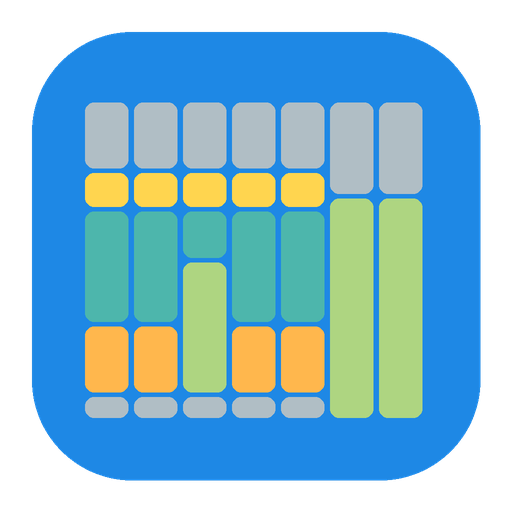
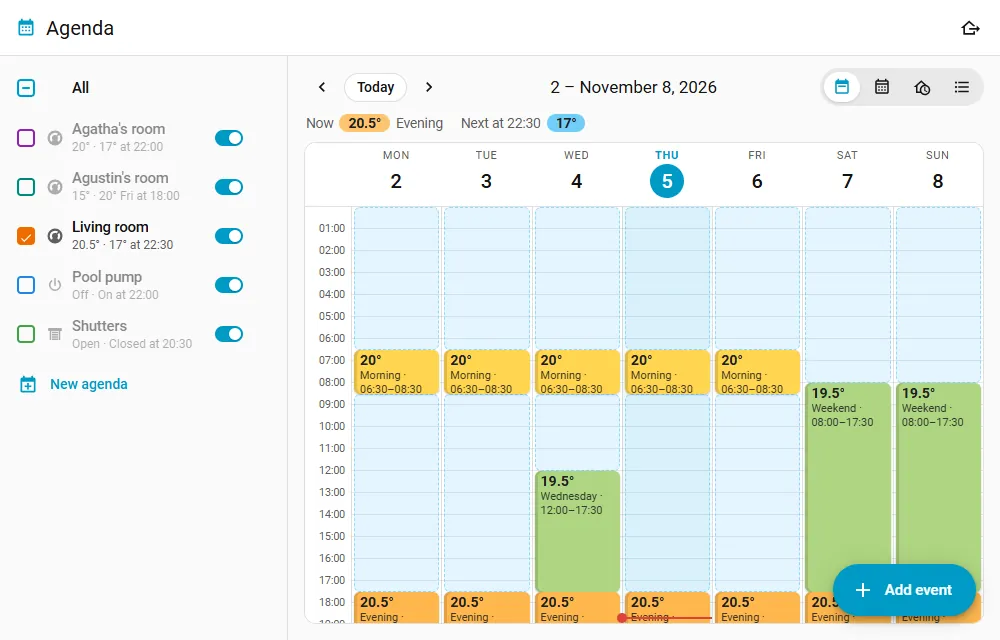
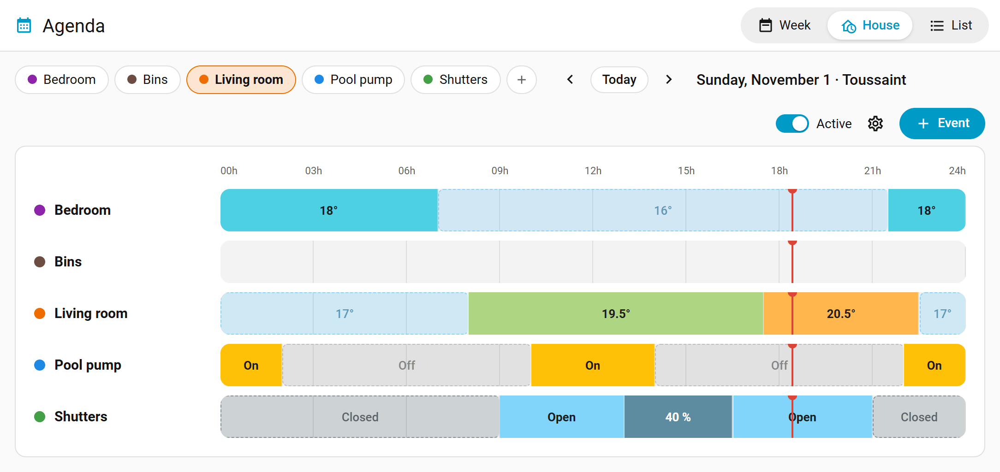
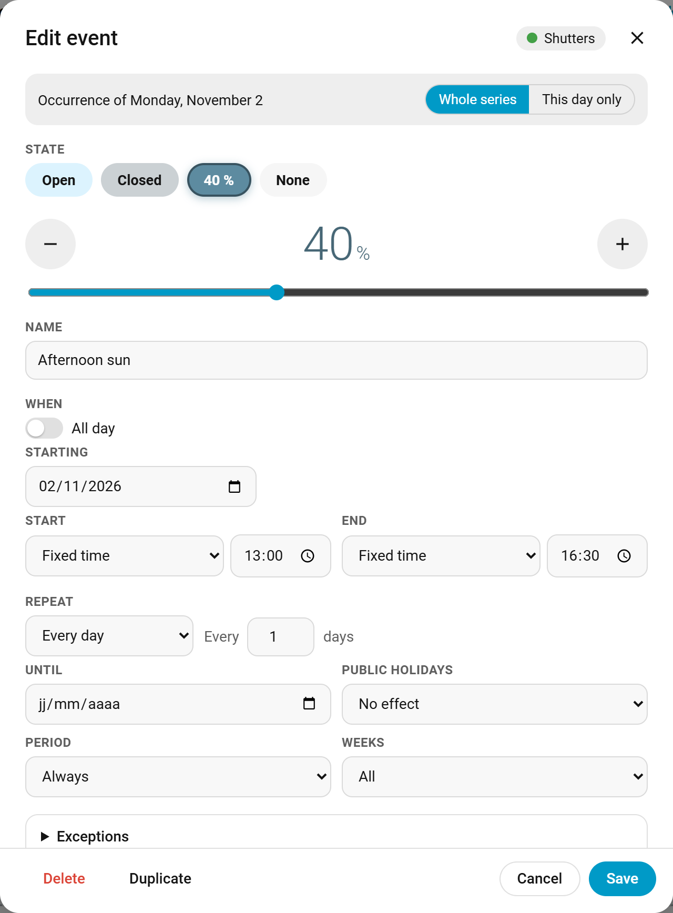
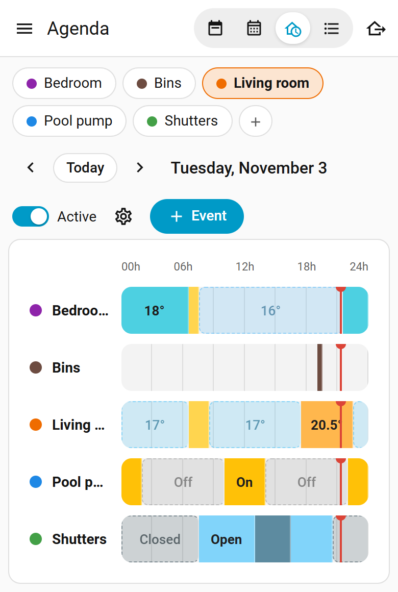

# Agenda for Home Assistant

Calendar-based scheduling for Home Assistant, inspired by the Agenda plugin of Jeedom.
Each room or device gets its own agenda, shown as a week you can edit by dragging blocks around.

[](https://my.home-assistant.io/redirect/marketplace_repository/?owner=jolabs40&repository=agenda-ha&category=integration)
[](https://github.com/jolabs40/agenda-ha/actions/workflows/validate.yml)

[Version française](README.fr.md) · [Deutsche Version](README.de.md) · [Nederlandse versie](README.nl.md)



[Watch the two-minute tour on YouTube](https://youtu.be/GYiXai78Mzg), with subtitles in nine languages.

An event sets what the linked devices should do (a temperature, a preset, on or off, a cover
position, an option, a value) and can run actions when it starts and ends. Outside events the
agenda goes back to its default state.

## Features

- A sidebar panel with four views:
  - Week: click an empty slot to add an event, drag a block to move it, pull its bottom edge to
    make it longer. Moving a repeated event asks whether it applies to that day or the whole series.
    On a touch screen, a long press picks a block up. A day can be copied to other days of the week.
    A block names the calendars its event depends on, and outlines the one that makes it run that
    day; the days a calendar takes out of a series show hatched.
    An event turned off (Event active, in its editor) shows faded and struck through, to be opened
    and turned back on; the block of an event with actions carries a small mark.
  - Month: each day's events, with public and school holidays.
  - House: every agenda over one day, with what each device is doing now and, for thermostats, the
    measured temperature drawn under the setpoint.
  - List: all events and how they repeat.
- On a wide screen the agendas are listed in a column, as in the Calendar panel: tick the ones to
  show, see what each one is doing and its next change, pause it or open its settings. On a phone,
  chips at the top do the same. The Add event button sits at the bottom right. The panel opens on
  the last tab picked, browser by browser, and the gear on the All row leads to the shared settings.
  The edge of the column can be dragged to make it wider, which each browser remembers too.
- Duplicate, in the settings of an agenda, makes a copy of it: same settings, same events, without
  the devices, to pick next.
- Other calendars of Home Assistant (school holidays, a family calendar...) can be ticked in the
  same column and show hatched in the week, month and house views, for information only.
- An event can last several days, from one date and time to another, repeated or not. Its
  exceptions look at the day it starts.
- Events repeat every N days, weeks (on chosen weekdays, or on even or odd weeks only) or months
  (on the same date, on the 2nd Monday, on the last Friday...), optionally until a date. Single
  days can be removed from or added to a series.
- The start or the end of an event can follow sunrise or sunset, with an offset, not before or at
  the latest at a given time.
- Conditions on entities: an event takes charge only while, for instance, someone is home, a
  window is closed or the outdoor temperature is below 5 °C; all of them, or at least one.
- A setpoint or a value can follow an entity, an `input_number` or a template sensor for instance:
  change it, and every event that follows it changes with it. The event's own value stays for when
  the entity has none.
- Public holidays of your country can be skipped, or used as the only days.
- Calendars can act as conditions: skip the days with an event in them (trips, absences), keep
  only those days, or both on the same event. With several calendars, an event in one of them is
  enough, or one is needed in each of them.
  Public holidays can be one of these calendars, for an event that runs on home office days or on
  public holidays. A calendar can also count only its events containing a text, such as the red
  days of an electricity tariff calendar.
  An event's own agenda can be one of them too: a repeated Friday gives way to a week of leave set
  in the same agenda. Only the events that do not depend on it count then.
- A school holiday calendar can be set once for all agendas. Each repeating event then applies
  always, only during school term, or only during school holidays, and the week view marks the
  holidays.
- Start and end actions per event, edited with the regular Home Assistant action editor.
- Changes made by hand are respected: a device set by hand is left as it is until the next change,
  or the next day, or put back at once, as chosen per agenda. A restart keeps them.
- Overrides: Skip to next applies the next change now, Apply now (in the event editor) applies an
  event until its end, Resume the schedule cancels them.
- Each device is followed up. One that is unavailable gets its state when it comes back; one that
  does not take its state gets a second try, then a Repairs issue. Devices without state feedback
  (radio covers) get their command once, one after the other with a short pause.
- Air conditioners: an event can set the mode, fan speed and swing with the temperature, or a mode
  alone (fan only, dry).
- An absence mode for the whole house: the agendas that follow it keep their away state until a
  date, or until it is stopped. The others (lights) can simulate presence meanwhile.
  A switch shows it to automations, and the dashboard card has its button.
- Per agenda: a `calendar` entity (Calendar panel, calendar triggers), an Active switch that
  pauses the agenda, Now and Next change sensors.
- Actions for automations and voice assistants: skip the next occurrence, add or remove dates,
  override the schedule, start or end the absence mode.
- The logbook names the agenda that changed a device, and two events let automations react.
- Non-admin users can be allowed to edit events and the absence; start and end actions stay with
  administrators.
- After a restart the linked devices are put back in the state the agenda expects (can be turned
  off per agenda), except those set by hand.
- A dashboard card, `custom:agenda-card`, with a visual editor.
- Reach the setpoint on time: a thermostat starts as early as needed for the room to be at its
  setpoint when the event starts. How fast the room warms up is learned.
- Temperatures in °C or °F, as set in Home Assistant.
- English, French, German and Dutch.

What an agenda can control:

| Kind | Entities | States |
|---|---|---|
| Thermostats | `climate` | temperature (with mode, fan and swing for air conditioners), preset, mode, off |
| On / off | `switch`, `light`, `input_boolean`, `fan` | on (with brightness for lights), off |
| Covers | `cover` | open, closed, position |
| Selector | `select`, `input_select` | one of the options |
| Value | `number`, `input_number` | a number |
| Nothing | | actions only |

Thermostats that publish their preset temperatures (Versatile Thermostat does) show them next
to the preset names.

| House view | Event editor | Phone |
|---|---|---|
|  |  |  |

## Installation

In Settings > Marketplace, search for Agenda (or use the button above) and select Install. The setup
of a first agenda follows, without a restart.

If it does not show up yet, select Add from link and enter `https://github.com/jolabs40/agenda-ha`
(this asks for a GitHub connection).

Before Home Assistant 2026.11, the Marketplace was the HACS integration: search for Agenda there,
download it and restart Home Assistant.

Without either, unzip `agenda.zip` from the [latest release](https://github.com/jolabs40/agenda-ha/releases/latest)
into a `custom_components/agenda` folder of your configuration (or copy that folder from this
repository) and restart Home Assistant.

After HACS or a copy by hand, add the Agenda integration from Settings > Devices & services. Each
entry is one agenda; more can be created from the panel with the New agenda button. Everything else
is set up in the Agenda panel.

Requires Home Assistant 2024.7 or later. The `holidays` package is installed automatically. The
integration icon shows from Home Assistant 2026.3.

## How the state is chosen

- The event in progress sets the state. Outside events, the default state of the agenda applies.
  Events without a state (reminders, actions only) are ignored here.
- When events overlap, the one that started last wins, and the shorter one on a tie. A whole-day
  Weekend event and a Night event starting at midnight: the night wins until it ends, then the
  weekend takes over.
- On each change, end actions run first, then the state is applied, then start actions run.
  Thermostats get their setpoint at every event start. Other devices are only called when their
  state differs, except devices without state feedback: what they show is only a guess, so they
  always get their command.
- Times are local clock times: an event at 21:30 stays at 21:30 when daylight saving time changes.
- Turning the Active switch off pauses the agenda completely.

## Changes made by hand

A device set by hand, on itself or in Home Assistant, is recognised as such. Changes made by hand
(in the settings of each agenda) decides what follows:

| Choice | What the agenda does |
|---|---|
| Kept until the next change (default) | leaves it until the next event starts or ends |
| Kept until the next day | leaves it until midnight |
| Put back at once as the agenda wants | sets it back after 5 seconds; after three times in ten minutes, leaves it until the next change |
| The agenda always wins | ignores it, the next change applies as usual |

A restart keeps these changes, and so does `agenda.resync`. Apply now in the settings takes every
device back. The column shows "set by hand until...", and the Now sensor lists these devices in its
`set_by_hand` attribute.

A thermostat that stops by itself is not changed by hand: Versatile Thermostat turns itself off
for an open window, its auto start and stop or its central mode, and keeps what it was asked. The
agenda goes by that request: it does not take the stop for a hand change, and still sends an Off
due meanwhile.

Overrides change the schedule itself, until the time they show (`override_until` on the Now
sensor): Skip to next applies the state of the next change at once (again: the one after), Apply
now in the event editor applies that event's state until the end of its next occurrence. Resume
the schedule cancels both, and takes back the devices set by hand.

## Reach the setpoint on time

Without this setting, a thermostat gets its setpoint when the event starts, and the room only
starts warming up then. With Reach the setpoint on time, in the settings of a thermostat agenda, it
starts early so that the room is there on time. This works with any `climate` entity (radiator
valve, air conditioner, heat pump, Versatile Thermostat), and an air conditioner cools early the
same way. The setting is off by default.

At each rise the agenda learns how fast the room goes, in °C per hour, and how long the device takes
to get going, for each thermostat, heating and cooling apart. It needs three rises; until then it
counts on 1.5 °C/h heating, 2.5 °C/h cooling and 10 minutes to get going. The lead is that time plus
the time of the rise, with a 10 % margin, up to the Longest lead (3 hours by default, from 15 minutes
to 6 hours). With several thermostats on an agenda, the slowest one decides and they all start
together.

A rise is not kept if someone changes the device, if it goes off or unavailable, if its setpoint
changes, during an absence, if it lasts more than twice the longest lead or if the gap at the start
is 0.5 °C or less. An open window shows that way: the device goes off or changes its setpoint, or
the measure falls.

At the time computed, the whole state of the event applies: setpoint, mode, fan, swing. An air
conditioner that is off therefore starts in the right mode. Start actions stay at the start.

| Case | What the agenda does |
|---|---|
| Event with a preset, a mode only, or off | nothing early, for lack of a number to reach |
| Way back to a lower setpoint when heating, or a higher one when cooling | nothing early |
| Agenda paused, absence, override, device set by hand, condition false | nothing early |
| Another event already started | it gives way to the early start |
| Another event starts between the early start and the start | it stays in charge until it ends, the early start waits |
| The estimate falls once the early start is under way | it goes on |
| The event goes, its condition becomes false, the absence starts, the agenda is paused | it stops and the agenda goes back to the state it wants |

The measure is the thermostat's. The thermometer of an air conditioner or a radiator valve often
reads far from the temperature of the room: Room temperature sensor replaces it with a sensor, and
without a value from that sensor nothing starts early. When the measure usually goes 0.8 °C or more
past the setpoint in the hour after a rise, the settings of the agenda say so: it is probably taken
near the device, and the learned speeds are too fast. Outdoor temperature, in the shared settings,
takes a sensor or a `weather` entity and corrects the learned speed by 30 % at most with the weather.

The settings of the agenda show the learned speeds and a button to forget them, like the
`agenda.reset_learning` action (on the agenda's calendar, `climate` for one thermostat only). The
Heating rate sensor gives the speed in °C/h, with `cool_rate`, `dead_time`, `samples` and
`last_sample`. The Next change sensor has the `preheat_start` and `preheat_minutes` attributes once
the time is computed. The Week and House views draw a hatched band before the event, and
`agenda_state_applied` carries the reason `preheat` with `preheat_minutes`, `preheat_start` and
`target_time`. The logbook says: "preheating by agenda Bedroom: 20 °C for 07:00 (started 05:42)".

## Actions

Actions work as in automations, with three extra variables:

| Variable | Content |
|---|---|
| `agenda` | name of the agenda |
| `phase` | `start` or `end` |
| `event` | `id`, `name`, `start`, `end` (ISO dates) |

```yaml
- action: notify.mobile_app_phone
  data:
    message: "{{ event.name }} ({{ agenda }}) {{ 'starts' if phase == 'start' else 'ends' }}"
```

Only administrators set actions. Users allowed to edit events do not see them, and their changes
keep the actions already in place.

In the week, the block of an event with actions carries a small mark at its bottom right.

## Sunrise, sunset and conditions

Sun times are computed by Home Assistant, day by day, for the location set in Settings > System >
General. When the sun brings the end of an event before its start (sunset after a fixed 21:00 end
in summer), the event is skipped that day. Not before and At the latest keep a sun time within
bounds: covers that close at sunset, but not before 18:00.

Conditions compare the state of an entity: `person.alex` is `home`, `binary_sensor.window` is not
`on`, `sensor.outdoor_temperature` is below `5`. With several conditions, the event needs all of
them or at least one of them. They are read when the event starts and whenever the entity changes.
An event whose conditions stop holding hands over to the next event in charge, or to the default
state; its end actions still run. An entity that becomes unavailable keeps its last state for ten
minutes, restarts included, so a sensor that drops out briefly changes nothing.

The week draws an event whose conditions do not hold right now faded and struck through, as it
does for a day a calendar removes: with one event per mode at the same time, only the one of the
current mode shows. Days to come are drawn as if the conditions kept their current state.

## A value that follows an entity

The setpoint of a thermostat, or the value of a Value agenda, can follow an entity instead of a
fixed number: an `input_number`, a `number` or a sensor, such as a template sensor giving a value
per mode. The device gets the entity's value when the event starts and again each time it changes,
brought to its step and within its bounds. The number set in the event stays for when the entity
has none; an entity that becomes unavailable first keeps its last value for ten minutes.

## Absence mode

The button at the top of the panel, or of the dashboard card, starts it, until a date or until it
is stopped; the actions `agenda.set_absence` and `agenda.end_absence` do the same from an
automation. Meanwhile each agenda
that follows it (an option in its settings) keeps its away state, or its default state, and runs
no action. At the end every agenda goes back to its schedule.

The switch `switch.agenda_absence` is on during an absence, with its end in the `until` attribute
(empty when it lasts until stopped): an automation can react to it, and turning it on starts an
absence until it is turned off. As in the panel, the switch and both actions are kept to
administrators, unless the shared settings let users edit events and the absence; automations
are not concerned.

An agenda that does not follow it can simulate presence instead (Presence simulation, in its
settings): during an absence its starts and ends move at random by up to the chosen number of
minutes, earlier or later, so lights do not go on at the same time every day.

## Automations

| Action | Target | Data |
|---|---|---|
| `agenda.skip_next` | an agenda's calendar | `event` (optional name): removes the next occurrence |
| `agenda.add_dates` | an agenda's calendar | `event`, `dates`: adds occurrences on these days |
| `agenda.remove_dates` | an agenda's calendar | `event`, `dates`: removes the occurrences on these days |
| `agenda.advance` | an agenda's calendar | applies the next change now (Skip to next) |
| `agenda.apply_event` | an agenda's calendar | `event` (name): applies that event until the end of its next occurrence |
| `agenda.resume` | an agenda's calendar | ends the override and takes back the devices set by hand |
| `agenda.reset_learning` | an agenda's calendar | forgets the learned speeds, of all its thermostats or of one (`climate`) |
| `agenda.set_absence` | | `until` (optional): starts the absence mode |
| `agenda.end_absence` | | ends it |
| `agenda.resync` | an agenda's calendar | puts the devices back in the state the agenda wants now, except those set by hand |

```yaml
- action: agenda.skip_next
  target:
    entity_id: calendar.agenda_living_room
  data:
    event: Morning
```

Each agenda's `calendar` entity also works with the calendar trigger of Home Assistant, with an
offset if needed:

```yaml
triggers:
  - trigger: calendar
    event: start
    entity_id: calendar.agenda_living_room
    offset: "-0:15:00"
actions:
  - action: notify.mobile_app_phone
    data:
      message: "{{ trigger.calendar_event.summary }} in 15 minutes"
```

## Events and logbook

Each state given to a device fires `agenda_state_applied`; a device that still does not show it
after a second try fires `agenda_state_failed` and gets a Repairs issue. Their data: `agenda`,
`entry_id`, `entity_id`, `state`, `label` (the state as shown in the panel), and for
`agenda_state_applied` the `reason` (`schedule`, `edit`, `resync`, `available`, `retry`, `preheat`...) and the
`event` (`id` and `name`) when an event set it.

```yaml
triggers:
  - trigger: event
    event_type: agenda_state_failed
actions:
  - action: notify.mobile_app_phone
    data:
      message: "{{ trigger.event.data.entity_id }} did not take {{ trigger.event.data.label }}"
```

The logbook shows a line for each state applied ("set by agenda Bedroom: 19 °C"), and the
changes of the device name the agenda as their cause. When the logbook is filtered on one device,
Home Assistant keeps only the lines of that device's integration: the cause is still shown there,
the agenda's own line only in the full logbook.

## Public holidays

They follow the country set in Settings > System > General. Another country, or a region (a US
state, a German Land, Alsace-Moselle...), can be picked in the settings of any agenda and applies
to all of them.

In the exceptions of an event, Public holidays also comes first in the calendar lists. The Public
holidays setting always narrows the days down, whereas a list combines its calendars: with Home
office and Public holidays under Only on days with an event (in at least one of them, the default),
the event runs on home office days and on public holidays alike.

## School holidays

Add a calendar holding the school holidays, for instance with the Remote Calendar integration and
the published calendar of your school zone, then pick it in the shared settings of any agenda.
In France the ministry publishes one per zone:
`https://fr.ftp.opendatasoft.com/openscol/fr-en-calendrier-scolaire/Zone-A.ics` (or `Zone-B`,
`Zone-C`, `Corse`).

A child away at boarding school during the week, for example: mark the weekday slots as School
term, and add an all-day daily event at the home temperature marked School holidays.

## Dashboard card

```yaml
type: custom:agenda-card
view: house                     # every agenda, today
agendas: [Bedroom, Living room] # optional: only these, in this order
title: Heating                  # optional
```

```yaml
type: custom:agenda-card
view: week
agenda: Bedroom
```

```yaml
type: custom:agenda-card
view: next                      # time left, state now, next change, Skip to next and Resume
agendas: [Bedroom]
```

The card has a visual editor. Clicking it opens the panel. Every view has a button to start or end
the absence mode, for the users allowed to, and a banner during an absence.

Every option is optional:

| Option | View | Effect |
|---|---|---|
| `agendas` | house, next | the agendas shown, in this order; all of them by name otherwise |
| `names` | all | another name in the card, for example `names: {Water heater couple: Couple}` |
| `title`, `icon` | all | the header; `title: ""` leaves it out |
| `absence: false` | all | no absence button nor banner |
| `tap_action` | all | what a click does, as in the cards of Home Assistant; the panel by default, `{action: none}` for nothing |
| `start_hour`, `end_hour` | house | the hours shown, from 0 to 24 |
| `name_width`, `row_height` | house | width of the names and height of a row, in pixels |
| `live: false` | house | no line under the name with what the device does now |
| `curve: false` | house | no temperature curve |
| `buttons: false` | next | no Skip to next nor Resume button |
| `days` | week | from 1 to 7; fewer than 7 starts today |
| `hour_height` | week | height of an hour, in pixels |

## Reporting a problem

In Settings > Devices & services > Agenda, the menu of the agenda concerned has Download
diagnostics: a file with its settings and events, its devices as they are now, and the last
commands sent to them with what each device showed. Attach it to an issue on
[GitHub](https://github.com/jolabs40/agenda-ha/issues), with what you expected and when.

For more, the menu at the top of the same page has Enable debug logging: wait for the problem, then
Disable debug logging, and Home Assistant downloads the log.

## Support

Agenda is free. If it is useful to you, you can buy me a coffee on [Ko-fi](https://ko-fi.com/jolabs40).

[](https://ko-fi.com/jolabs40)

A star on this repository also helps other people find it.

## License

[MIT](LICENSE)
