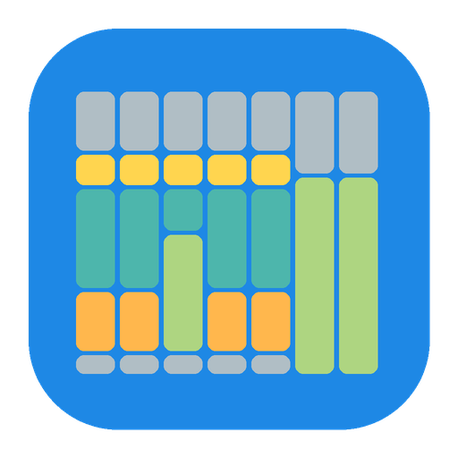
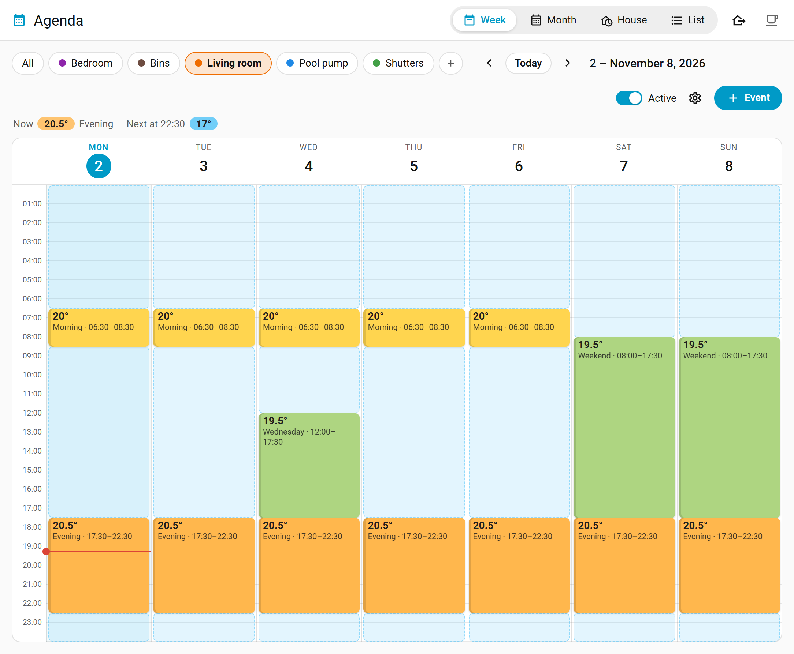
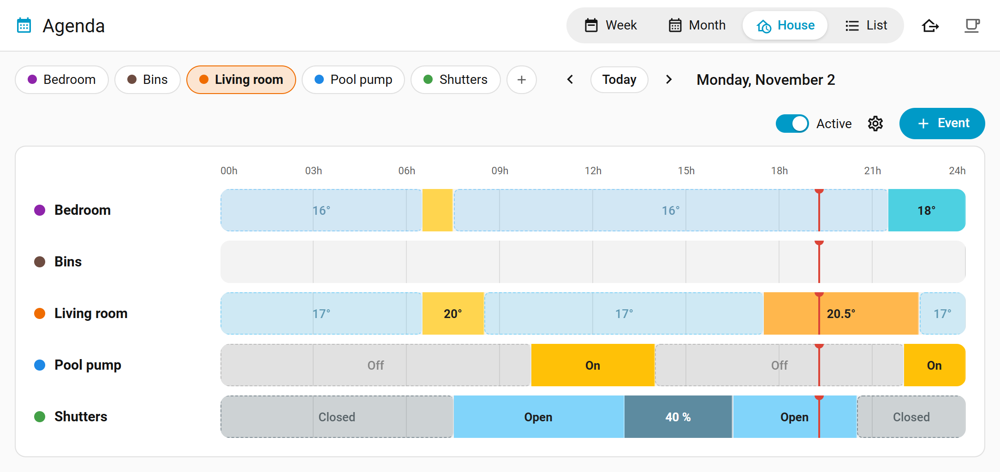
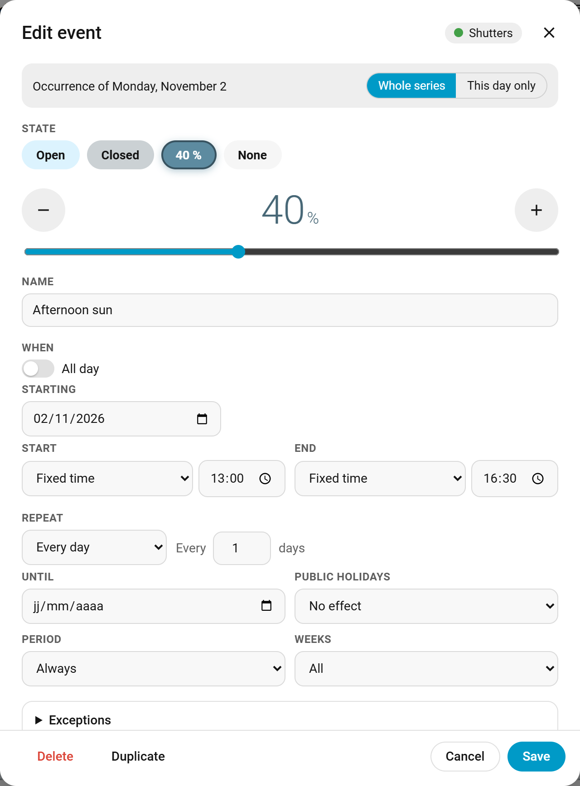
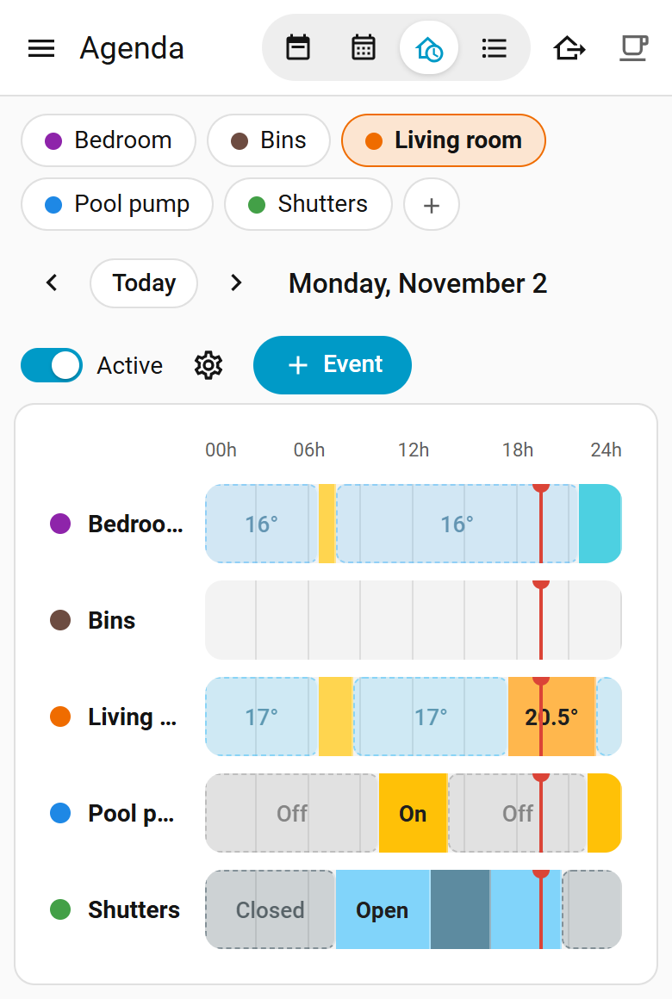

# Agenda voor Home Assistant

Planning met een kalender voor Home Assistant, naar het voorbeeld van de Agenda-plugin van Jeedom.
Elke kamer of elk apparaat krijgt een eigen agenda, getoond als een week die je bewerkt door
blokken te verslepen.

[](https://my.home-assistant.io/redirect/hacs_repository/?owner=jolabs40&repository=agenda-ha&category=integration)
[](https://github.com/jolabs40/agenda-ha/actions/workflows/validate.yml)

[English version](README.md) · [Version française](README.fr.md) · [Deutsche Version](README.de.md)



[Bekijk de presentatie van twee minuten op YouTube](https://youtu.be/GYiXai78Mzg), met ondertitels in negen talen, ook in het Nederlands.

Een gebeurtenis bepaalt wat de gekoppelde apparaten moeten doen (een temperatuur, een modus, aan
of uit, een rolluikpositie, een optie, een waarde) en kan acties uitvoeren bij het begin en aan
het einde. Buiten gebeurtenissen keert de agenda terug naar haar standaardtoestand.

De schermafbeeldingen zijn in het Engels; de interface verschijnt in het Nederlands als Home
Assistant in het Nederlands staat.

## Functies

- Een paneel in de zijbalk met vier weergaven:
  - Week: een klik op een vrij tijdslot voegt een gebeurtenis toe, een blok verplaats je door het
    te slepen en verleng je door aan de onderrand te trekken. Bij een herhaalde gebeurtenis kies je
    tussen alleen deze dag en de hele reeks. Op een aanraakscherm pakt lang drukken het blok op.
    Een dag kun je naar andere dagen van de week kopiëren.
  - Maand: de gebeurtenissen van elke dag, met feestdagen en schoolvakanties.
  - Huis: alle agenda's over één dag, met wat elk apparaat nu doet.
  - Lijst: alle gebeurtenissen en hun herhaling.
- Herhaling elke N dagen, weken (op gekozen weekdagen, of alleen in even of oneven weken) of
  maanden (op dezelfde datum, op de 2e maandag, op de laatste vrijdag...), eventueel tot een datum.
  Losse dagen kun je uit een reeks halen of eraan toevoegen.
- Het begin of het einde van een gebeurtenis kan de zonsopgang of zonsondergang volgen, met een
  verschuiving.
- Voorwaarden op entiteiten: een gebeurtenis neemt het alleen over zolang er bijvoorbeeld iemand
  thuis is of een raam dicht is.
- De feestdagen van je land kunnen worden overgeslagen, of de enige dagen zijn.
- Kalenders kunnen als voorwaarde dienen: dagen met een gebeurtenis erin overslaan (reizen,
  afwezigheden) of alleen die dagen houden. Bij meerdere kalenders volstaat een gebeurtenis in één
  ervan, of moet er een in elk staan.
- Een kalender van de schoolvakanties kies je één keer voor alle agenda's. Elke herhaalde
  gebeurtenis geldt dan altijd, alleen in de schoolperiode of alleen in de schoolvakantie, en het
  weekoverzicht markeert de vakanties.
- Acties bij het begin en aan het einde van elke gebeurtenis, met de gewone actie-editor van Home
  Assistant.
- Een afwezigheidsmodus voor het hele huis: de agenda's die hem volgen, houden hun
  afwezigheidstoestand tot een datum, of tot hij wordt gestopt.
- Per agenda: een `calendar`-entiteit (Kalender-paneel, kalendertriggers), een schakelaar Actief die
  de agenda pauzeert, de sensoren Nu en Volgende wijziging.
- Acties voor automatiseringen en spraakassistenten: de volgende gebeurtenis overslaan, datums
  toevoegen of verwijderen, de afwezigheidsmodus starten of beëindigen.
- Gebruikers zonder beheerdersrechten kunnen gebeurtenissen mogen bewerken.
- Na een herstart worden de gekoppelde apparaten in de toestand gezet die de agenda verwacht (per
  agenda uit te schakelen).
- Een dashboardkaart, `custom:agenda-card`.
- In het Engels, Frans, Duits en Nederlands.

Wat een agenda kan aansturen:

| Type | Entiteiten | Toestanden |
|---|---|---|
| Thermostaten | `climate` | temperatuur, modus, uit |
| Aan / uit | `switch`, `light`, `input_boolean`, `fan` | aan (met helderheid voor lampen), uit |
| Rolluiken | `cover` | open, dicht, positie |
| Keuzelijst | `select`, `input_select` | een van de opties |
| Waarde | `number`, `input_number` | een getal |
| Niets | | alleen acties |

Thermostaten die de temperatuur van hun modi publiceren (Versatile Thermostat doet dat), tonen die
naast de naam van de modus.

| Huisweergave | Gebeurtenis-editor | Telefoon |
|---|---|---|
|  |  |  |

## Installatie

Met HACS de knop hierboven gebruiken, of in HACS het menu openen, Aangepaste repositories kiezen en
`https://github.com/jolabs40/agenda-ha` toevoegen met het type Integratie. Agenda downloaden en
Home Assistant herstarten.

Zonder HACS `custom_components/agenda` naar de map `custom_components` van je configuratie
kopiëren en Home Assistant herstarten.

Daarna de integratie Agenda toevoegen via Instellingen > Apparaten & diensten. Elk item is één
agenda; meer maak je in het paneel met de knop +. Al het andere stel je in het Agenda-paneel in.

Vereist Home Assistant 2024.7 of nieuwer. Het pakket `holidays` wordt automatisch geïnstalleerd.
Het pictogram van de integratie verschijnt vanaf Home Assistant 2026.3.

## Welke toestand geldt

- De lopende gebeurtenis bepaalt de toestand. Buiten gebeurtenissen geldt de standaardtoestand van
  de agenda. Gebeurtenissen zonder toestand (herinneringen, alleen acties) tellen hier niet mee.
- Als gebeurtenissen overlappen, wint de laatst begonnen gebeurtenis, bij gelijkstand de kortste.
  Een weekendgebeurtenis van een hele dag en een nachtgebeurtenis die om middernacht begint: de
  nacht wint tot ze afloopt, daarna neemt het weekend het over.
- Bij elke wissel lopen eerst de acties aan het einde, dan wordt de toestand toegepast, dan lopen
  de acties bij het begin. Thermostaten krijgen hun instelwaarde bij het begin van elke
  gebeurtenis, dus een handmatige wijziging blijft tot de volgende gebeurtenis. Andere apparaten
  worden alleen aangesproken als hun toestand afwijkt.
- Tijden zijn lokale kloktijden: een gebeurtenis om 21:30 blijft bij de overgang naar zomer- of
  wintertijd om 21:30.
- De schakelaar Actief pauzeert de agenda volledig.

## Acties

Acties werken zoals in automatiseringen, met drie extra variabelen:

| Variabele | Inhoud |
|---|---|
| `agenda` | naam van de agenda |
| `phase` | `start` of `end` |
| `event` | `id`, `name`, `start`, `end` (ISO-datums) |

```yaml
- action: notify.mobile_app_telefoon
  data:
    message: "{{ event.name }} ({{ agenda }}) {{ 'begint' if phase == 'start' else 'eindigt' }}"
```

## Zonsopgang, zonsondergang en voorwaarden

De tijden van de zon berekent Home Assistant dag voor dag voor de locatie die is ingesteld onder
Instellingen > Systeem > Algemeen. Als de zon het einde van een gebeurtenis vóór het begin brengt
(zonsondergang na een vast einde om 21:00 in de zomer), vindt de gebeurtenis die dag niet plaats.

Voorwaarden vergelijken de toestand van een entiteit: `person.alex` is `home`,
`binary_sensor.raam` is niet `on`. Ze worden gelezen bij het begin van de gebeurtenis en bij elke
wijziging van de entiteit. Een gebeurtenis waarvan de voorwaarden niet meer kloppen, laat het over
aan de volgende gebeurtenis, of aan de standaardtoestand; haar acties aan het einde lopen toch.

## Afwezigheidsmodus

De knop bovenaan het paneel start hem, tot een datum of tot hij wordt gestopt; de acties
`agenda.set_absence` en `agenda.end_absence` doen hetzelfde vanuit een automatisering. Intussen
houdt elke agenda die hem volgt (een optie in haar instellingen) haar afwezigheidstoestand, of
anders haar standaardtoestand, en voert ze geen actie uit. Aan het einde keert elke agenda terug
naar haar programma.

## Automatiseringen

| Actie | Doel | Gegevens |
|---|---|---|
| `agenda.skip_next` | de kalender van een agenda | `event` (naam, optioneel): verwijdert de volgende gebeurtenis |
| `agenda.add_dates` | de kalender van een agenda | `event`, `dates`: voegt op deze dagen gebeurtenissen toe |
| `agenda.remove_dates` | de kalender van een agenda | `event`, `dates`: verwijdert de gebeurtenissen op deze dagen |
| `agenda.set_absence` | | `until` (optioneel): start de afwezigheidsmodus |
| `agenda.end_absence` | | beëindigt hem |
| `agenda.resync` | de kalender van een agenda | zet de apparaten in de toestand die de agenda nu wil |

```yaml
- action: agenda.skip_next
  target:
    entity_id: calendar.agenda_woonkamer
  data:
    event: Ochtend
```

## Feestdagen

Ze volgen het land dat is ingesteld onder Instellingen > Systeem > Algemeen. Een ander land, of een
regio (een Duitse deelstaat, een Amerikaanse staat...), kies je in de instellingen van een
willekeurige agenda en geldt voor alle agenda's.

## Schoolvakanties

Voeg een kalender met de schoolvakanties toe, bijvoorbeeld met de integratie Remote Calendar en een
gepubliceerde iCal-kalender van de vakanties van je regio (Noord, Midden of Zuid), en kies hem in de
gedeelde instellingen van een willekeurige agenda.

Een kind dat doordeweeks op een internaat zit, bijvoorbeeld: markeer de doordeweekse gebeurtenissen
als Schoolperiode, en voeg een dagelijkse gebeurtenis van een hele dag toe met de temperatuur voor
thuis, gemarkeerd als Schoolvakantie.

## Dashboardkaart

```yaml
type: custom:agenda-card
view: house                       # alle agenda's, vandaag
agendas: [Slaapkamer, Woonkamer]  # optioneel filter
title: Verwarming                 # optioneel
```

```yaml
type: custom:agenda-card
view: week
agenda: Slaapkamer
```

Een klik op de kaart opent het paneel.

## Steun

Agenda is gratis. Heb je er iets aan, dan kun je me een koffie trakteren op [Ko-fi](https://ko-fi.com/jolabs40).

[](https://ko-fi.com/jolabs40)

Een ster voor deze repository helpt anderen ook om haar te vinden.

## Licentie

[MIT](LICENSE)
